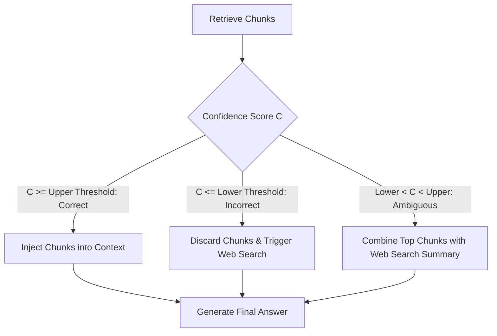
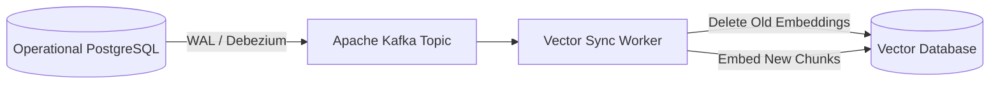

# Block B: RAG (Retrieval-Augmented Generation) — Deep-Dive Learning Guide & Senior Interview Q&A

> **Module**: Block B: Retrieval-Augmented Generation (3 Hours Intensive)  
> **Target Audience**: AI Engineers, Enterprise Search Architects, Senior Backend Candidates  
> **Directory**: `C:\Users\COM\Desktop\sample\block-b-rag-mastery\`

---

# PART 1: COMPREHENSIVE LEARNING GUIDE

## 1. Why RAG? (Parametric vs. Non-Parametric Memory)

Language models maintain knowledge across two fundamentally distinct memory tiers:
1. **Parametric Memory**: Knowledge frozen inside the model weights $\theta$ during training.
   - *Weaknesses*: Knowledge cutoff dates, hallucinations on niche or proprietary facts, inability to delete copyrighted/PII data, astronomical re-training costs.
2. **Non-Parametric Memory**: External dynamic indexes (Vector Stores, Document Repositories, SQL Databases).
   - *Strengths*: Real-time updates, unlimited scale, granular access control, transparent source attribution.

**RAG (Retrieval-Augmented Generation)** acts as an open-book exam: given a question, the system dynamically retrieves verified source passages from non-parametric stores and passes them into the LLM context window to ground the generation.

---

## 2. The 8-Stage RAG Pipeline Architecture

```
1. LOAD       Extract raw text & layout metadata from PDFs, HTML, DOCX, Databases.
     │
2. CLEAN      Strip headers, footers, boilerplate, and normalize character encodings.
     │
3. CHUNK      Segment text into discrete semantic windows with boundary overlap.
     │
4. EMBED      Convert chunk text into dense mathematical vectors (Bi-Encoder).
     │
5. STORE      Index embeddings and metadata into a Vector Database (HNSW / IVF).
     │
6. RETRIEVE   Match user query vector against chunk vectors (Top-k, MMR, Hybrid RRF).
     │
7. AUGMENT    Construct prompt: System directives + Retrieved Chunks + Inline Citation rules.
     │
8. GENERATE   LLM synthesizes truthful, grounded answer with verifiable source citations.
```

---

## 3. Chunking Strategies & Overlap Dynamics

Chunk size governs the balance between **retrieval specificity** (small chunks) and **semantic context** (large chunks):

| Chunking Strategy | Description | Best Suited For | Failure Modes |
| :--- | :--- | :--- | :--- |
| **Fixed-Length** | Splits strictly every $N$ characters/tokens. | Simple text baselines. | Splits words, severs sentences mid-thought. |
| **Recursive Character** | Recursively tests `["\n\n", "\n", ". ", " "]`. | **Standard enterprise documents, PDFs**. | May produce variable-sized chunks. |
| **Document-Structure** | Splits on Markdown headers (`#`, `##`), HTML tags, or PDF sections. | Technical specs, API docs, manuals. | Inconsistent chunk lengths. |
| **Semantic Splitting** | Splits when cosine distance between consecutive sentences exceeds a statistical threshold. | Highly unstructured narratives. | High embedding latency during ingestion. |
| **Parent-Child (Small-to-Big)** | Indexes small child chunks for vector search; returns parent paragraph to the LLM. | **Production enterprise RAG**. | Requires dual-index mapping overhead. |

### The Mechanics of Chunk Overlap
Without overlap, information spanning two chunks is fractured. An overlap of **15%–25% (e.g., 80 characters)** ensures that transitional clauses and relational facts remain intact in at least one chunk.

---

## 4. Embedding Models & Vector Spaces

- An embedding model is a **Bi-Encoder** neural network (e.g., `gemini-embedding-001`, `text-embedding-3-large`) that maps text into a high-dimensional vector space $\mathbb{R}^D$ ($D=768, 1536, 3072$).
- **Distance Metrics**:
  1. **Cosine Similarity**: Measures orientation angle $\cos(\theta)$, invariant to document length:
     $$\text{CosineSim}(\vec{u}, \vec{v}) = \frac{\vec{u} \cdot \vec{v}}{\|\vec{u}\|_2 \|\vec{v}\|_2} \in [-1, 1]$$
  2. **Dot Product (Inner Product)**: Equivalent to Cosine Similarity when vectors are $L_2$-normalized ($\|\vec{u}\| = 1$), but computationally much faster.
  3. **Euclidean Distance ($L_2$)**: Measures straight-line spatial distance. Sensitive to text length unless normalized.

---

## 5. Vector Database Engines Compared

| Database | Primary Architecture | Index Mechanism | Best Production Use Case |
| :--- | :--- | :--- | :--- |
| **FAISS** (Meta) | C++ Local / In-Memory Library | HNSW, IVF, PQ | Offline batch evaluation, maximum local query throughput. |
| **Chroma** | Embedded SQLite / DuckDB | HNSW | Local prototyping, desktop agents, Python-native microservices. |
| **pgvector** | PostgreSQL Extension | HNSW, IVFFlat | Applications with existing relational DBs; requires ACID joins. |
| **Azure AI Search** | Cloud Enterprise Managed | HNSW + BM25 + Semantic Ranker | Microsoft ecosystem, HIPAA/FedRAMP, hybrid search pipelines. |
| **Pinecone** | Cloud Distributed Serverless | Proprietary Graph ANN | High-scale, multi-tenant cloud-native SaaS, zero maintenance. |

---

## 6. Retrieval Mechanics: Top-K, MMR, Hybrid Search & Re-Ranking

### 6.1 Top-K Similarity Search
Selects the $k$ chunks with highest cosine similarity. Fast, but frequently retrieves multiple redundant chunks from the exact same page.

### 6.2 Maximal Marginal Relevance (MMR)
Balances **Relevance** to query $q$ with **Diversity** among already-selected chunks $S$:

$$\text{MMR} = \operatorname{argmax}_{d_i \in R \setminus S} \left[ \lambda \cdot \text{Sim}(d_i, q) - (1 - \lambda) \max_{d_j \in S} \text{Sim}(d_i, d_j) \right]$$
- $\lambda = 1.0$: Pure Top-K relevance (high redundancy).
- $\lambda = 0.5$: Optimal balance of relevance and cross-topic diversity.

### 6.3 Hybrid Search (BM25 + Dense Vectors via RRF)
- **Dense Vectors**: Semantic matches (`"worker leaves"` $\to$ `"separated employee"`).
- **Sparse BM25**: Exact keywords, acronyms, and product IDs (`"AUD-STD-2026-V4"`).
- **Reciprocal Rank Fusion (RRF)**: Merges ranked lists without needing score calibration:
  $$\text{RRF\_Score}(d) = \sum_{m \in M} \frac{1}{k + r_m(d)} \quad (k \approx 60)$$

### 6.4 Two-Stage Retrieval with Cross-Encoder Re-Ranking
- **Stage 1 (Bi-Encoder)**: Fast $\mathcal{O}(1)$ approximate retrieval of top-50 candidate chunks.
- **Stage 2 (Cross-Encoder Re-Ranker)**: Evaluates full joint self-attention across $(Query, Chunk)$ pairs to re-score and select the true top-5 with maximum precision.

---

## 7. Advanced RAG Paradigms

```
┌────────────────────────────────────────────────────────────────────────┐
│                        ADVANCED RAG TAXONOMY                           │
├────────────────────┬───────────────────────────────────────────────────┤
│ Query Rewriting    │ LLM reformulates colloquial queries into search terms.│
├────────────────────┼───────────────────────────────────────────────────┤
│ HyDE               │ Embeds a generated hypothetical answer instead of  │
│                    │ the raw user question to search document space.   │
├────────────────────┼───────────────────────────────────────────────────┤
│ GraphRAG           │ Indexes entities & relationships into knowledge   │
│                    │ graphs for multi-hop relational reasoning.        │
├────────────────────┼───────────────────────────────────────────────────┤
│ Agentic RAG        │ LLM dynamically decides when to search, which DB  │
│                    │ to query, and iterates if facts are insufficient. │
└────────────────────┴───────────────────────────────────────────────────┘
```

---

## 8. Document Parsing Realities: PDFs, Tables & OCR

- **PDF Visual Stream**: PDFs store text as disconnected spatial coordinates (`x, y`), not sequential paragraphs. Multi-column PDFs often read across columns naively.
- **Tables**: Spatial tables lose semantic rows/columns when flattened into text. Modern approaches convert tables to Markdown or HTML tables during parsing.
- **Scanned Images**: Requires OCR engines (Tesseract, Google Cloud Document AI, AWS Textract) followed by layout analysis.

---

## 9. Evaluation: The RAG Triad & RAGAS Framework

```
                    [User Query]
                     /        \
           Context Relevance  Answer Relevance
                   /            \
                  ▼              ▼
           [Retrieved Context] ──► [LLM Answer]
                     Faithfulness
```

1. **Context Relevance**: Measures whether retrieved chunks are relevant to the query (evaluates Retriever).
2. **Faithfulness / Groundedness**: Measures whether every claim in the answer is factually entailed by the retrieved context (evaluates Hallucination rate).
3. **Answer Relevance**: Measures whether the answer directly addresses the user's intent (evaluates Generator).

---

## 10. Access Control (RBAC/DLS) & Data Privacy

- **Document-Level Security (DLS)**: In enterprise RAG, users must only access documents permitted by their Role-Based Access Control (RBAC) groups.
- **Pre-Filtering Implementation**: User identity groups are injected into the vector query metadata filter (`filter={"department": {"$in": user_groups}}`), ensuring unauthorized document vectors are never evaluated during nearest-neighbor search.

---

## 11. Strategic Decision Matrix: RAG vs. Fine-Tuning vs. Long Context

| Factor | RAG | Fine-Tuning | Long Context Window (1M+ Tokens) |
| :--- | :--- | :--- | :--- |
| **Primary Goal** | Grounding with dynamic external knowledge. | Customizing tone, style, syntax, specialized tasks. | Complex in-memory reasoning over large unified docs. |
| **Knowledge Freshness** | **Real-time (instant upon indexing)**. | Static (frozen at training time). | Dynamic (must upload data per call). |
| **Audit Provenance** | **Yes (exact file, page, paragraph citations)**. | No (weights are opaque; no citations). | Partial (citations possible, but noisy). |
| **Inference Cost** | Low per query. | Low per query. | Very High (linear token cost per inference). |

---

# PART 2: GRADED INTERVIEW QUESTIONS & MODEL ANSWERS (BASIC TO STAFF LEVEL)

```
========================================================================================
                          BLOCK B INTERVIEW ROADMAP BY LEVEL
========================================================================================
 [TIER 1: BASIC / JUNIOR]         [TIER 2: INTERMEDIATE / MID]       [TIER 3: ADVANCED / SENIOR]        [TIER 4: SYSTEM DESIGN / STAFF]
 - RAG vs Vanilla LLM             - Recursive vs Semantic Chunking   - Bi-Encoder vs Cross-Encoder      - 10M-Doc Enterprise RAG Arch
 - Vector Embeddings & Dimensions - BM25 vs Dense Vector Search      - HNSW Graph Skip-List Mechanics   - RAGAS Evaluator (4 Metrics)
 - Cosine Similarity Math [-1,1]  - Exact kNN vs ANN Tradeoffs       - Reciprocal Rank Fusion (RRF)     - GraphRAG & Community Clusters
 - Chunking & Overlap Mechanics   - Metadata Pre- vs Post-Filtering  - Maximal Marginal Relevance (MMR) - Agentic RAG & Self-RAG Loops
 - Vector DB vs SQL Tables        - Audit Citation Prompt Design     - Parent-Child (Small-to-Big)
 - Top-k Selection Failure Modes  - PDF Tables & Layout Extraction   - HyDE Mechanics & Failure Cases
                                  - RAG vs Fine-Tune vs Long Context - Multi-Query Sub-Decomposition
                                                                     - Document-Level Security (RBAC)
========================================================================================
```

---

## TIER 1: BASIC LEVEL (JUNIOR AI ENGINEER / ASSOCIATE)

### Q1: What is RAG (Retrieval-Augmented Generation), and what core problems does it solve compared to a vanilla LLM?
**Difficulty**: Basic / Junior  
**Topic**: RAG Fundamentals

#### Model Answer:
**RAG (Retrieval-Augmented Generation)** is an architectural pattern that combines an external information retrieval system with a generative language model:
1. **The Ingestion & Query Loop**:
   - Private/domain documents are split into chunks, converted to vector embeddings, and indexed in a vector store.
   - At query time, the user's question is converted into an embedding to retrieve the top-$k$ most relevant document chunks.
   - The retrieved chunks are inserted into the prompt as factual context for the LLM to synthesize the final answer.
2. **Core Problems Solved**:
   - **Eliminates Knowledge Cutoffs**: LLM training weights are frozen at pre-training time. RAG provides real-time access to live company data and today's updates without retraining.
   - **Suppresses Hallucinations**: Grounds the LLM in verified source text rather than relying on probabilistic parametric memory.
   - **Auditability & Traceability**: Provides exact citations (document name, page number, section) so compliance and audit teams can verify every claim.
   - **Data Privacy & Access Control**: LLM weights cannot enforce user-level permissions. RAG enables filtering data based on user authorization groups before the LLM sees it.

---

### Q2: What is an embedding vector, and what does the dimensionality (e.g., 768, 1536, 3072) represent?
**Difficulty**: Basic / Junior  
**Topic**: Vector Embeddings

#### Model Answer:
1. **Definition**: An **embedding vector** is an array of floating-point numbers (e.g., `[-0.014, 0.082, ..., 0.005]`) that maps discrete text into a continuous high-dimensional geometric space $\mathbb{R}^D$.
2. **What Dimensions Represent**:
   - In classical NLP, each dimension represented a discrete word frequency (one-hot encoding).
   - In modern deep neural models, dimensions represent **latent semantic features** (e.g., syntactical relationships, topics, sentiment, entity attributes) learned automatically during training.
   - Texts with similar semantic meaning (e.g., `"The server crashed"` and `"The database suffered an unexpected outage"`) are mapped to vectors that point in nearly identical directions in vector space.
3. **Dimensionality ($D$) Tradeoffs**:
   - *Higher Dimensions (e.g., 3072 dims in Gemini / OpenAI text-embedding-3-large)*: Captures subtle, fine-grained semantic distinctions, but increases vector storage memory and search latency.
   - *Lower Dimensions (e.g., 384 or 768 dims)*: Highly compact and fast, but may suffer collision on subtle domain-specific technical concepts.

---

### Q3: What is Cosine Similarity? State its mathematical formula, numerical range, and why it is preferred over Euclidean distance for text embeddings.
**Difficulty**: Basic / Junior  
**Topic**: Distance Metrics & Linear Algebra

#### Model Answer:
**Cosine Similarity** measures the cosine of the angle $\theta$ between two non-zero vectors $\vec{u}$ and $\vec{v}$:

$$\text{CosineSim}(\vec{u}, \vec{v}) = \cos(\theta) = \frac{\vec{u} \cdot \vec{v}}{\|\vec{u}\| \|\vec{v}\|} = \frac{\sum_{i=1}^D u_i v_i}{\sqrt{\sum_{i=1}^D u_i^2} \sqrt{\sum_{i=1}^D v_i^2}}$$

- **Numerical Range**: $[-1, 1]$
  - $1.0$: Identical direction (maximal semantic similarity).
  - $0.0$: Orthogonal (independent / unrelated concepts).
  - $-1.0$: Diametrically opposite direction (rare in text embeddings; usually bounded $[0, 1]$ for normalized embeddings).
- **Why Preferred over Euclidean Distance ($L_2$)**:
  - Euclidean distance $d(\vec{u}, \vec{v}) = \sqrt{\sum (u_i - v_i)^2}$ is heavily sensitive to the **magnitude (length)** of the vectors. A short sentence and a long paragraph covering the exact same topic might have different vector magnitudes, resulting in a large Euclidean distance.
  - Cosine similarity normalizes vector lengths to $1.0$ (unit hypersphere), evaluating **purely the directional angle** of semantic meaning regardless of document length.

---

### Q4: What is document chunking, and why is "chunk overlap" critical during text splitting?
**Difficulty**: Basic / Junior  
**Topic**: Ingestion Pipeline Engineering

#### Model Answer:
1. **Document Chunking**: The process of breaking large documents (100-page PDFs, manuals) into smaller, coherent text segments (e.g., 500 characters or 250 tokens).
   - *Why Chunk?*: Embedding an entire 50-page document into a single vector averages out specific facts, diluting retrieval precision. Chunks ensure that retrieved passages are tightly focused on the query.
2. **Why Chunk Overlap is Critical**:
   - If a document is split strictly at character 1000 with zero overlap, a crucial sentence or entity definition may be sliced directly in half:
     - *Chunk 1 End*: `"...the mandatory password rotation cycle is"`
     - *Chunk 2 Start*: `"90 days for all privileged administrators."`
   - Neither chunk independently contains the complete semantic fact!
   - **Chunk Overlap (e.g., 100 characters / 20%)**: Re-reads the trailing tokens of the previous chunk into the beginning of the next chunk. This guarantees semantic continuity across boundaries, preventing factual fragmentation.

---

### Q5: What is a Vector Database, and how does its querying mechanism differ from a traditional Relational (SQL) database?
**Difficulty**: Basic / Junior  
**Topic**: Database Architecture

#### Model Answer:
| Dimension | Relational Database (SQL - PostgreSQL, MySQL) | Vector Database (Pinecone, Chroma, Qdrant, Milvus) |
| :--- | :--- | :--- |
| **Data Stored** | Structured scalar types (INT, VARCHAR, TIMESTAMP, JSON). | Dense high-dimensional floating-point vectors + Metadata payloads. |
| **Primary Index** | B-Tree, Hash Index, LSM-Tree. | HNSW (Graph), IVF (Inverted File), ScaNN. |
| **Search Mechanism** | **Deterministic Exact Matching**: `WHERE status = 'ACTIVE' AND price < 50`. | **Probabilistic Nearest Neighbor**: Find top-$k$ vectors closest to query vector by angle/distance. |
| **Query Complexity** | $\mathcal{O}(\log N)$ exact lookup. | $\mathcal{O}(\log N)$ Approximate Nearest Neighbor (ANN). |
| **Primary Use Case** | Transactional ledger, ERP, relational state, inventory. | Semantic text search, image similarity, multimodal retrieval, RAG. |

---

### Q6: In top-$k$ retrieval, what does $k$ represent, and what are the failure modes of setting $k$ too small vs. too large?
**Difficulty**: Basic / Junior  
**Topic**: Information Retrieval Tuning

#### Model Answer:
In vector retrieval, $k$ specifies the exact number of top-ranked candidate chunks returned by the nearest-neighbor search to be injected into the LLM prompt.

- **Failure Mode: $k$ is Too Small ($k=1$ or $2$)**:
  - **Low Retrieval Recall**: Complex questions often require synthesizing facts spread across multiple pages (e.g., comparing SLA terms in Section 2 against refund rules in Section 8). If $k$ is too small, essential supporting context is omitted, forcing the LLM to hallucinate or reply `"I don't know"`.
- **Failure Mode: $k$ is Too Large ($k=20$ or $50$)**:
  - **Context Dilution & "Lost in the Middle"**: LLMs struggle to pay attention to relevant facts buried among dozens of noisy, marginally relevant chunks.
  - **Prompt Cost & Latency Explosion**: Each extra chunk adds 300–500 tokens to the input, increasing Time to First Token (TTFT) and API billing costs proportionally.
- **Production Sweet Spot**: $k=3$ to $5$ high-quality chunks after re-ranking.

---

## TIER 2: INTERMEDIATE LEVEL (MID-LEVEL AI ENGINEER)

### Q7: Fixed-Size Chunking vs. Recursive Character Chunking vs. Semantic Chunking: How do they work, and what are their trade-offs?
**Difficulty**: Mid-Level  
**Topic**: Document Splitting Strategies

#### Model Answer:
```
1. FIXED-SIZE:
   [----- Chunk 1 (500 chars) -----][----- Chunk 2 (500 chars) -----]
   (Splits words/sentences arbitrarily in the middle)

2. RECURSIVE CHARACTER:
   Checks "\n\n" (Paragraphs) -> Fits? Keep.
   No? -> Checks "\n" (Lines) -> Fits? Keep.
   No? -> Checks " " (Words) -> Fits? Keep.
   (Preserves natural semantic grammatical units)

3. SEMANTIC CHUNKING:
   Sentence 1 --(Embed)--\
   Sentence 2 --(Embed)----> Cosine Sim > Threshold? Group together.
   Sentence 3 --(Embed)--/   Cosine Sim < Threshold? Split new chunk!
```

| Strategy | Algorithmic Mechanism | Tradeoffs |
| :--- | :--- | :--- |
| **Fixed-Size Chunking** | Slices text at fixed character or token intervals (e.g. every 500 chars). | Extremely fast, but cuts off sentences mid-word, destroying semantic integrity. Rarely suitable for production. |
| **Recursive Character Chunking** | Iterates through a hierarchy of natural separators: `["\n\n", "\n", " ", ""]`. Attempts to split at paragraphs first; falls back to sentence or word boundaries only if a chunk exceeds size limit. | **Industry standard**. Fast, predictable, preserves syntactic paragraphs, minimal edge-case failures. |
| **Semantic Chunking** | Splits text into individual sentences, generates embeddings for each sentence, and computes cosine similarity between adjacent sentences. When similarity drops below a percentile threshold (semantic shift), a new chunk boundary is formed. | High semantic purity per chunk, but computationally expensive (requires hundreds of embedding model API calls per document). |

---

### Q8: Compare Dense Vector Search with Sparse Keyword Search (BM25 / TF-IDF). When does vector search fail where BM25 succeeds?
**Difficulty**: Mid-Level  
**Topic**: Lexical vs Semantic Search

#### Model Answer:
- **Dense Vector Search (Semantic)**:
  - Embeds query and documents into continuous vector space.
  - Excels at synonyms, conceptual meaning, and multi-word semantic intent (e.g. query `"cardiac arrest treatment"` matches `"myocardial infarction emergency protocol"` even with zero overlapping words).
- **Sparse Keyword Search (BM25 - Lexical)**:
  - Matches exact character sequences weighted by Term Frequency (TF) and Inverse Document Frequency (IDF).
  - Scores rare, unique tokens heavily across documents.

#### When Dense Vector Search Fails (and BM25 Succeeds):
1. **Exact Product SKUs, Model Numbers, and Error Codes**:
   - Query: `"Error 0x80070005 access denied"`. An embedding model maps this near generic Windows errors, losing the exact hex code. BM25 matches the exact string `0x80070005` with $100\%$ precision.
2. **Proper Nouns & Rare Technical Identifiers**:
   - Query: `"Dr. Hans-Jürgen von der Vogelweide"`, `"CVE-2024-38077"`, or `"AC-2(1)"`. Embedding models tokenize rare names into arbitrary subwords, degrading vector distance.
3. **Short Keyword Queries**:
   - Query: `"SOC2 Type II Section 4.1"`. Vector search treats this conceptually, while BM25 treats `"4.1"` as a high-value lexical token.

---

### Q9: Exact k-Nearest Neighbors (kNN) vs. Approximate Nearest Neighbors (ANN): Explain the recall vs. latency tradeoff in production.
**Difficulty**: Mid-Level  
**Topic**: Vector Index Optimization

#### Model Answer:
- **Exact kNN (Flat Index)**:
  - Computes the true dot product / cosine distance between the query vector and **every single vector** in the index.
  - *Recall*: **$100\%$ guaranteed exact nearest neighbors**.
  - *Complexity*: Linear $\mathcal{O}(N \times D)$. For 10 million vectors of dimension 1536, querying requires $\approx 15 \text{ billion}$ floating-point operations ($\approx 500\text{ms} - 2\text{s}$ latency). Unusable for real-time applications.
- **Approximate Nearest Neighbors (ANN - HNSW, IVF, ScaNN)**:
  - Organizes vectors into hierarchical graphs (HNSW) or Voronoi partitioned clusters (IVF).
  - Restricts search to a small subset of candidate nodes/clusters likely to contain the nearest neighbors.
  - *Complexity*: Sub-linear or logarithmic $\mathcal{O}(\log N)$. Queries complete in **$5 - 20\text{ms}$**.
  - *Trade-off*: Sacrifices $1\% - 3\%$ recall (an approximate neighbor at rank 6 might be returned instead of true rank 5). In RAG applications, this minor discrepancy is completely unnoticeable to downstream LLMs.

---

### Q10: Pre-Filtering vs. Post-Filtering with metadata in vector databases: Why is post-filtering dangerous for small top-$k$ queries?
**Difficulty**: Mid-Level  
**Topic**: Vector Metadata Filtering

#### Model Answer:
Suppose a user queries an enterprise knowledge base with metadata filter: `department = 'Finance'` and requests `top_k = 5`.

- **Post-Filtering (The Anti-Pattern)**:
  1. The vector database performs ANN search across the *entire* index first, retrieving the global top-5 nearest vectors.
  2. It then inspects the metadata of those 5 vectors and filters out any where `department != 'Finance'`.
  3. **The Catastrophic Failure**: If the global top-5 nearest neighbors happened to belong to `'Engineering'`, post-filtering discards all 5, returning **0 results** to the user, even though hundreds of relevant Finance documents existed deeper in the database!
- **Pre-Filtering (Production Standard)**:
  1. The query engine applies the metadata constraint *before* or *during* the graph traversal.
  2. Non-matching vectors are excluded from candidate evaluation.
  3. Guarantees that all $k=5$ returned results strictly satisfy the metadata filter.

---

### Q11: How do you structure an LLM prompt to guarantee strict source citations and prevent the model from leaking external parametric memory?
**Difficulty**: Mid-Level  
**Topic**: Grounded Prompt Engineering

#### Model Answer:
To force an LLM to rely strictly on retrieved context and provide audit-grade citations:

```markdown
SYSTEM PROMPT:
You are a regulatory compliance auditor. Your sole task is to answer the user's question using ONLY the provided verified context chunks below.

MANDATORY RULES:
1. Every factual statement or recommendation MUST be followed by an inline citation referencing the Chunk ID and Section, e.g., [Doc-1, Sec 4.2].
2. If the provided context does not contain sufficient information to answer the question with 100% certainty, state: "The provided reference documents do not contain information regarding [topic]."
3. DO NOT extrapolate, assume, or utilize prior training knowledge outside of the provided context.
4. Directly quote the exact phrasing from the source document before providing your synthesis.

--- CONTEXT CHUNKS ---
[Chunk-1 | Source: ISO27001_Standard.pdf | Section: A.9.2.1]
User access rights to systems must be reviewed at regular intervals not exceeding 90 days.

[Chunk-2 | Source: SOC2_Trust_Services.pdf | Section: CC6.1]
Logical access controls are enforced through centralized directory services with multi-factor authentication.
----------------------

USER QUESTION:
What is the mandatory timeframe for user access reviews?
```

- **Why this works**: Clear structural delimiters (`--- CONTEXT CHUNKS ---`), negative constraints (`DO NOT extrapolate`), and the quote-first requirement anchor attention heads directly on the provided context tokens.

---

### Q12: Why is table extraction in PDFs notoriously difficult for standard text splitters, and what is the production-grade approach to handle tabular data in RAG?
**Difficulty**: Mid-Level  
**Topic**: Document Parsing & Multimodality

#### Model Answer:
**The Problem**: Standard text loaders (e.g., PyPDF, PDFMiner) extract raw text strings sequentially by reading stream coordinates. When reading a table, the extractor reads horizontally across rows without preserving column boundaries, resulting in garbled text:
`"Q1 Revenue Expense Net Income $50M $30M $20M"` $\to$ numbers lose their column headers.
When chunked, a table can be sliced in half, completely separating values from their column headers.

**Production Solutions**:
1. **Layout-Aware Vision / Table Models**: Use specialized document layout models (e.g., Microsoft Table-Transformer, Google Cloud Document AI, or unstructured.io) to detect table bounding boxes and serialize them into structured **Markdown or HTML tables**:
   ```markdown
   | Quarter | Revenue | Expense | Net Income |
   |---------|---------|---------|------------|
   | Q1      | $50M    | $30M    | $20M       |
   ```
   Markdown tables preserve relative grid alignment in the token space.
2. **Table Summarization (Multi-Vector Retrieval)**:
   - An LLM generates a comprehensive text summary of the table: `"Summary of Q1-Q4 financial table showing revenue, expense, and net income..."`.
   - The *summary* is embedded into the vector store.
   - When retrieved, the *raw structured table* is passed into the context window for the generator LLM.

---

### Q13: Strategic Decision Framework: RAG vs. Fine-Tuning vs. Long Context Window (1M+ tokens). How do you advise leadership?
**Difficulty**: Mid-Level  
**Topic**: Architecture Strategy

#### Model Answer:
| Metric | RAG | Fine-Tuning | Long-Context Window (1M+) |
| :--- | :--- | :--- | :--- |
| **Primary Strength** | Dynamic, verifiable knowledge retrieval. | Deep style, syntax, and task-specific alignment. | In-memory reasoning across unified massive documents. |
| **Knowledge Update Frequency** | **Instantaneous** (seconds to index new docs). | Weeks/Months (requires retraining runs). | Per-query upload (dynamic, but high latency). |
| **Factual Verifiability** | **Full Audit Trail** (exact file & line citation). | Black-box weights (zero citations). | Moderate (citations possible, but noisy). |
| **Cost at Scale** | Fixed vector DB cost + small input token cost per query. | Low per-token inference cost. | **Extremely Expensive** (paying for 1M tokens every query). |
| **Data Security & RBAC** | Native (metadata pre-filtering per user). | Impossible (weights cannot hide data by user role). | Manual (must pre-filter before prompt construction). |

**Executive Recommendation**: Default to **RAG** for enterprise knowledge bases and audit-sensitive workflows. Use **Fine-Tuning** exclusively for style, format, or latency reduction. Use **Long-Context** for single-session document analysis (e.g., analyzing an entire codebase or trial transcript once).

---

## TIER 3: ADVANCED LEVEL (SENIOR AI ENGINEER)

### Q14: What is the architectural difference between a Bi-Encoder and a Cross-Encoder? Why don't we use Cross-Encoders for the entire document retrieval corpus?
**Difficulty**: Senior  
**Topic**: Information Retrieval & Neural Search

#### Model Answer:
- **Bi-Encoder (Embedding Models)**:
  Processes the Query $q$ and Document $d$ through separate forward passes (or the same Siamese network independently):
  $$\vec{u} = \text{Encoder}(q), \quad \vec{v} = \text{Encoder}(d)$$
  The similarity is computed via a simple vector dot-product: $\text{Score} = \vec{u} \cdot \vec{v}$.
  *Advantage*: Document vectors can be pre-computed offline and indexed into an HNSW vector database. At query time, only the query vector is computed, allowing retrieval across 10 million documents in milliseconds ($\mathcal{O}(1)$ or $\mathcal{O}(\log N)$ via ANN).
  *Drawback*: Query and document tokens cannot attend to each other; representation is bottlenecked into a single vector.
- **Cross-Encoder (Re-Ranker Models)**:
  Concatenates query and document into a single sequence: `[CLS] query [SEP] document [EOS]` and passes it through the Transformer.
  *Advantage*: Every token in the query attends to every token in the document via cross-attention, capturing complex semantic subtleties, negations, and exact relationships.
  *Drawback*: Cannot pre-compute document representations offline! Running a Cross-Encoder across 1 million documents would require 1 million full Transformer forward passes for a single query, which is computationally impossible in real-time.
- **Production Solution**: A **Two-Stage Pipeline**:
  1. Bi-Encoder retrieves top-50 candidate chunks in 15ms.
  2. Cross-Encoder re-ranks only the top-50 candidates in 30ms, yielding the final top-5 chunks.

---

### Q15: Explain the HNSW (Hierarchical Navigable Small World) algorithm. Why is it preferred over flat brute-force search in vector databases?
**Difficulty**: Senior / Staff  
**Topic**: Vector Indexing & ANN Algorithms

#### Model Answer:
Exact k-Nearest Neighbors (kNN) brute-force search computes the distance between the query vector and every vector in the database, scaling linearly with corpus size: $\mathcal{O}(N \times D)$. For $N = 10,000,000$ and $D=1536$, a single query requires tens of billions of floating-point operations.

**HNSW (Hierarchical Navigable Small World)** is an Approximate Nearest Neighbor (ANN) graph algorithm that scales logarithmically: $\mathcal{O}(\log N)$.
- **Architecture**: A multi-layer hierarchical graph analogous to a **Skip-List**:
  - *Top Layers*: Sparse graphs with long-range links between distant vector clusters.
  - *Bottom Layer ($Layer_0$)*: Dense graph containing all vector nodes with short-range links between near neighbors.
- **Search Process**:
  1. Query starts at the top layer and greedily traverses links toward nodes with highest cosine similarity.
  2. When a local minimum is reached in that layer, search drops down to the corresponding node in the next layer below.
  3. This repeats until $Layer_0$, where localized greedy search identifies the top-$k$ nearest neighbors.
- **Trade-off**: Sacrifices $1\% - 2\%$ recall accuracy (Approximate NN) in exchange for a $1,000\times$ speedup, enabling sub-20ms queries across millions of high-dimensional vectors.

---

### Q16: How does Reciprocal Rank Fusion (RRF) mathematically combine sparse BM25 keyword rankings with dense vector rankings? Why is it superior to naive score addition?
**Difficulty**: Senior  
**Topic**: Hybrid Search

#### Model Answer:
In Hybrid Search, BM25 returns unbounded lexical matching scores (e.g., $18.42, 12.10$), while dense vector search returns bounded cosine similarity scores (e.g., $0.82, 0.74$). Naively adding these scores together ($\text{Score} = \text{Score}_{\text{BM25}} + \text{Score}_{\text{Vector}}$) fails because BM25 scores vary wildly based on document length and term frequency, completely drowning out vector scores.

**Reciprocal Rank Fusion (RRF)** ignores raw score values and operates purely on **ordinal ranks**:

$$\text{RRF\_Score}(d \in D) = \sum_{m \in M} \frac{1}{k + r_m(d)}$$

- $M$: Set of ranking systems (e.g., BM25 and Vector Search).
- $r_m(d)$: The ordinal rank of document $d$ in system $m$ ($1, 2, 3, \dots$).
- $k$: Smoothing constant (typically $k=60$) that prevents top-ranked items from excessively dominating the distribution.
- **Advantage**: It is completely score-agnostic, robust to outlier scales, and guarantees that documents appearing consistently high in both lexical and semantic searches rise to the top.

---

### Q17: What is Maximal Marginal Relevance (MMR)? How does its mathematical objective function eliminate redundant duplicate chunks?
**Difficulty**: Senior  
**Topic**: Diversity in Retrieval

#### Model Answer:
**The Problem**: In dense vector search, if a policy document repeats the same sentence across 5 different sections, standard similarity search returns 5 near-identical chunks, consuming the context window with redundant noise.

**Maximal Marginal Relevance (MMR - Carbonell & Goldstein)** balances **query relevance** with **diversity across already selected chunks**:

$$\text{MMR} = \operatorname{argmax}_{d_i \in R \setminus S} \left[ \lambda \cdot \text{Sim}_1(d_i, q) - (1 - \lambda) \cdot \max_{d_j \in S} \text{Sim}_2(d_i, d_j) \right]$$

- $q$: User query vector.
- $R$: Set of candidate retrieved documents.
- $S$: Set of already-selected documents (starts empty).
- $\text{Sim}_1(d_i, q)$: Similarity between candidate chunk and the query (relevance).
- $\max_{d_j \in S} \text{Sim}_2(d_i, d_j)$: Maximum similarity between candidate chunk and any chunk already chosen (redundancy penalty).
- $\lambda \in [0, 1]$:
  - $\lambda = 1.0$: Pure similarity search (identical to standard top-$k$).
  - $\lambda = 0.5$: Balanced trade-off between topical relevance and document diversity.
  - $\lambda = 0.0$: Maximum diversity.

---

### Q18: What is Parent-Child (Small-to-Big) Chunking, and why does decoupling the retrieval unit from the generation unit improve accuracy?
**Difficulty**: Senior  
**Topic**: Advanced Indexing Architectures

#### Model Answer:
In standard RAG, there is a fundamental architectural conflict in chunk sizing:
- **Small Chunks (e.g., 100 tokens)**: Ideal for **retrieval**. Dense vectors are sharp, focused, and unpolluted by surrounding text, matching specific queries with high cosine similarity. However, they lack broad context for synthesis.
- **Large Chunks (e.g., 1000 tokens)**: Ideal for **generation**. They provide rich background context for the LLM to understand nuanced relationships, but their embedding vectors are diffuse and muddy.

#### Parent-Child (Small-to-Big) Architecture:
1. **Ingestion**:
   - Divide documents into large **Parent Chunks** (e.g., 1500 tokens).
   - Further subdivide each parent chunk into multiple small **Child Chunks** (e.g., 150 tokens).
   - In the vector database, **embed and index only the Child Chunks**, but store a reference `metadata={"parent_id": "P-101"}`. Store the Parent Chunks in an adjacent key-value store (e.g., Redis or SQLite).
2. **Retrieval**:
   - Query vector matches the highly specific Child Chunks.
3. **Augmentation**:
   - Before passing context to the LLM, look up the unique `parent_id`s corresponding to the matched child chunks and swap in the full **Parent Chunks**.
- **Outcome**: Optimal vector retrieval precision combined with comprehensive LLM synthesis context.

---

### Q19: Explain the HyDE (Hypothetical Document Embeddings) technique. When does it excel, and in what scenario does it catastrophically fail?
**Difficulty**: Senior  
**Topic**: Advanced RAG & Query Optimization

#### Model Answer:
**Concept**: In standard RAG, the user query (short, interrogative: `"What is AC-3?"`) is embedded and compared against document chunks (long, declarative). This query-document mismatch reduces retrieval recall.

**HyDE (Gao et al., 2022)** uses an LLM to generate a *hypothetical* answer first:
1. LLM receives query: `"What is AC-3?"` and hallucinates a hypothetical standard text.
2. The hypothetical document is embedded into vector space $\mathbb{R}^D$.
3. The search engine searches for real document chunks close to the hypothetical text (declarative-to-declarative vector matching).

- **When It Excels**: Open-ended, conceptual queries where the user does not know domain keywords (e.g., `"How does the company handle employee separation?"`).
- **Catastrophic Failure Mode**: **Fact-checking, specific entity lookups, and exact numerical specs**. If the user asks `"What was our Q3 revenue in Germany?"`, the LLM will hallucinate a random plausible revenue figure in the hypothetical answer. The vector database will then retrieve documents matching the hallucinated figure rather than the true German Q3 revenue!

---

### Q20: Multi-Query Retrieval & Query Decomposition: How do you handle multi-part, compound user queries in RAG?
**Difficulty**: Senior  
**Topic**: Query Transformation

#### Model Answer:
**The Problem**: A user asks: `"Compare the data retention requirements under SOC-2 with our internal GDPR policy for customer credit cards."`
A single embedding vector of this compound sentence will attempt to average both concepts, failing to retrieve optimal chunks for either individual compliance standard.

#### Solution: Query Decomposition Pipeline:
1. **Sub-Query Generation**: An LLM decomposes the compound query into atomic single-intent sub-queries:
   - $Q_1$: `"What are the data retention requirements under SOC-2 CC6.5?"`
   - $Q_2$: `"What is the internal GDPR policy for customer credit card storage?"`
2. **Parallel Retrieval**: Execute independent vector retrievals for $Q_1$ and $Q_2$ against the vector store.
3. **Deduplication & Union**: Merge retrieved chunk sets, deduplicate overlapping IDs, and pass both context sets into the synthesis prompt.
4. **Synthesis**: The LLM compares the side-by-side evidence to formulate the final answer.

---

### Q21: How do you implement Document-Level Security (DLS) in an enterprise vector database without rebuilding the index for each user?
**Difficulty**: Senior / Staff  
**Topic**: Security & Multi-Tenancy

#### Model Answer:
In enterprise RAG, users must only retrieve information they have clearance to see (e.g., HR salaries, executive memos).

**The Anti-Pattern**: Creating a separate vector collection for every user or role. This leads to index duplication, massive storage bloat, and operational maintenance nightmares.

**Production-Grade Architecture: Single-Index Metadata Pre-Filtering**:
1. **Ingestion Time**: Every document chunk indexed into the vector store is tagged with access control lists (ACLs) in its metadata payload:
   ```json
   {
     "text": "Executive compensation package...",
     "metadata": {
       "doc_id": "hr-exec-2026",
       "allowed_groups": ["c-level", "hr-directors"],
       "tenant_id": "corp-us"
     }
   }
   ```
2. **Query Time (Pre-Filtering)**: When user Alice queries the system, her verified JWT identity token is inspected to extract her group memberships: `["engineering", "corp-us"]`.
3. The vector database query applies a mandatory pre-filter before vector distance calculation:
   ```python
   retriever = vector_store.as_retriever(
       search_kwargs={
           "filter": {
               "tenant_id": "corp-us",
               "allowed_groups": {"$in": user_groups}
           }
       }
   )
   ```
4. Vectors not matching the filter are skipped during the graph traversal. Unauthorized data can never leak into the prompt context.

---

## TIER 4: SYSTEM DESIGN & STAFF / PRINCIPAL ARCHITECT LEVEL

### Q22: Enterprise System Design: Architect a 10-Million Document Real-Time RAG System with sub-500ms latency, high availability, strict multi-tenant ACLs, and continuous real-time CDC indexing.
**Difficulty**: Staff / Principal Architect  
**Topic**: Large-Scale System Design

#### Model Answer:

```
[INGESTION PIPELINE - ASYNC CDC]
Enterprise Sources (SharePoint, Confluence, S3, Salesforce)
        |
        v (Debezium Change Data Capture)
  [Kafka Topic: doc_events]
        |
        v
  [Doc Parser Workers] (Apache Flink / Ray cluster)
        |---> OCR & Table Extraction (DocAI / LayoutParser)
        |---> Semantic Chunking & Parent-Child Splitting
        |---> Batch Embedding API (Gemini / OpenAI)
        v
  [Vector DB: Milvus / Qdrant Distributed Cluster] + [Doc Store: PostgreSQL/S3]
  (HNSW Index, Sharded by tenant_id)

=============================================================================

[QUERY PIPELINE - REAL-TIME (<500ms SLA)]
User Query + JWT Token
        |
        v
  [Envoy Gateway] (JWT Validation, Extract user_id & security_groups)
        |
        v
  [Query Orchestrator (Go / Rust)]
        |---> Query Rewrite / HyDE (Fast LLM, TTFT < 100ms)
        |---> Parallel Fan-out:
        |       1. BM25 Sparse Search (Elasticsearch) [Pre-filtered by groups]
        |       2. Dense Vector Search (Qdrant ANN)   [Pre-filtered by groups]
        v
  [RRF Fusion Engine] (Combines Top-50 candidates via Reciprocal Rank Fusion)
        |
        v
  [Cross-Encoder Re-ranker Service (Triton Inference Server)]
        (Re-ranks Top-50 to Top-5 via BGE-Reranker-Large in 25ms)
        |
        v
  [Parent Context Hydration] (Fetches full parent chunks from Redis)
        |
        v
  [LLM Synthesis Stream (vLLM / Gemini API)] ---> Server-Sent Events (SSE) to User
```

#### Key Architectural Guarantees:
1. **CDC Real-Time Indexing**: Document updates in enterprise sources trigger Kafka events. Workers process, re-chunk, and upsert vectors in under 30 seconds without full re-indexing.
2. **Two-Stage Hybrid Retrieval**:
   - Stage 1: BM25 + Qdrant ANN retrieve 50 candidates in 30ms.
   - Stage 2: Cross-Encoder on Triton server re-ranks to 5 candidates in 25ms.
3. **Sub-500ms Latency Budget**:
   - Query rewrite: 90ms.
   - Hybrid retrieval: 35ms.
   - Cross-encoder rerank: 25ms.
   - Context hydration: 10ms.
   - Generator TTFT: 180ms.
   - **Total latency to first token: $\approx 340\text{ms}$**.

---

### Q23: Walk through the RAGAS evaluation framework. How do you measure "Faithfulness" vs "Answer Relevance" without ground-truth human labels?
**Difficulty**: Senior / Lead AI Engineer  
**Topic**: RAG Evaluation & LLM-as-a-Judge

#### Model Answer:
RAGAS (Retrieval-Augmented Generation Assessment) evaluates RAG pipelines using **LLM-as-a-Judge** with structured prompt chains, eliminating the need for expensive ground-truth reference datasets:

1. **Faithfulness (Groundedness)**:
   - *Goal*: Measure whether the generated answer is strictly grounded in the retrieved context (checking for hallucinations).
   - *Procedure*:
     1. An evaluation LLM breaks the generated answer into discrete atomic claims: $S = \{s_1, s_2, \dots, s_n\}$.
     2. For each claim $s_i$, the evaluator verifies whether $s_i$ can be directly inferred from the retrieved context $C$.
     3. $\text{Faithfulness} = \frac{|\text{Verified Claims}|}{|\text{Total Claims}|} \in [0, 1]$.
2. **Answer Relevance**:
   - *Goal*: Measure whether the response directly addresses the user's question.
   - *Procedure*:
     1. The generated answer is passed to an LLM, which reverse-engineers $k$ hypothetical questions that this answer would best respond to.
     2. Compute the cosine similarity between the embeddings of the generated questions and the original user query:
        $$\text{Answer Relevance} = \frac{1}{k} \sum_{i=1}^{k} \text{CosineSim}(\vec{q}_{\text{generated}, i}, \vec{q}_{\text{original}})$$
     3. If the model answered with tangential rambling, the generated questions will diverge from the original query, lowering the score.
3. **Context Recall**:
   - Evaluates whether the retriever fetched all necessary information present in the ground-truth reference.
4. **Context Precision**:
   - Evaluates whether the most relevant chunks are ranked at the top of the context window.

---

### Q24: GraphRAG vs. Vector RAG: Knowledge graph construction, Leiden community clustering, and answering global multi-hop summary queries across massive document corpora.
**Difficulty**: Staff / Principal Architect  
**Topic**: GraphRAG Architecture

#### Model Answer:
**The Vector RAG Bottleneck**: Vector RAG is inherently a **local search** mechanism. It excels at answering: `"What is the salary of John Doe?"` (point lookup).
However, Vector RAG catastrophically fails at **global dataset-level thematic queries** such as:
`"What are the top 5 recurring supply-chain vulnerabilities identified across all vendor audit reports over the last 3 years?"`
Because this information is not isolated in 3 contiguous chunks, vector search retrieves random vendor chunks, missing the holistic macro-theme.

#### GraphRAG Architecture (Microsoft Research):
1. **Extraction Phase**:
   - An LLM processes all text chunks to extract entities (e.g., `Vendor`, `Vulnerability`, `Country`) and typed relationships (`[Vendor A] EXPOSED_TO [Vulnerability B]`).
2. **Knowledge Graph Construction**:
   - Build a massive directed property graph with entities as nodes and relationships as edges.
3. **Hierarchical Community Detection (Leiden Algorithm)**:
   - Apply the Leiden graph algorithm to partition the graph into hierarchical clusters/communities of densely interconnected entities.
4. **Community Summarization**:
   - An LLM generates holistic narrative summaries for every detected community at multiple hierarchical levels (root level, sub-community level).
5. **Global Query Execution**:
   - When a global question arrives, query the community summaries in parallel.
   - Intermediate answers are synthesized into a global executive answer.
- **Tradeoff**: Ingestion is $5\times - 10\times$ more expensive due to LLM graph extraction, but it provides unprecedented multi-hop reasoning and macro-synthesis capabilities that vector search cannot achieve.

---

### Q25: Agentic RAG & Self-RAG: Designing an adaptive retrieval state machine with query re-writing, self-grading of retrieved chunks, and fallback to web search.
**Difficulty**: Staff / Principal Architect  
**Topic**: Agentic RAG Architecture

#### Model Answer:
Traditional RAG is rigid: `Query -> Retrieve -> Generate`. If retrieval returns garbage, the LLM hallucinates anyway.

**Agentic RAG (Self-RAG / Corrective RAG - CRAG)** introduces an active control loop where an agent dynamically grades its own retrieval and adapts:

```
                  [User Query]
                       |
                       v
              [Retrieval Step]
                       |
                       v
         [Chunk Relevance Grader (LLM)]
                       |
         +-------------+-------------+
         |                           |
    (Relevant)                  (Irrelevant)
         |                           |
         v                           v
  [Generate Answer]           [Query Rewriter]
         |                           |
         v                           v
  [Hallucination Grader]       [Fallback Search: Web / Google]
         |                           |
  (Pass: Deliver)                    +---> [Re-try Retrieval Loop]
  (Fail: Re-generate)
```

1. **Retrieval Grading**: A fast classifier evaluates whether retrieved chunks actually contain the factual answer.
2. **Corrective Routing**:
   - If chunks are *irrelevant*, the agent triggers a **Query Rewriter** node to formulate alternate keyword variants and re-tries retrieval.
   - If local database has zero coverage, the agent routes to an external Web Search tool (e.g., Google Search API).
3. **Hallucination Grading**:
   - After generation, the model verifies its own output claims against the context chunks before sending the response to the user. If ungrounded, it re-prompts with stricter temperature.


---

### Q26: Sentence-Window Retrieval: Decoupling the retrieval target from context injection. How does it work and why does it outperform fixed chunking?
**Difficulty**: Intermediate / Senior  
**Topic**: Advanced Retrieval Techniques

#### Model Answer:
In standard chunking, a chunk of 500 tokens is both the **retrieval unit** (embedded into the vector database) and the **generation context** (injected into the LLM prompt).
- *Problem*: Large 500-token chunks dilute semantic density because diverse topics are blended together into a single average vector. Conversely, tiny 50-token chunks have high embedding specificity but lack surrounding narrative context for the LLM to understand.

**Sentence-Window Retrieval Pattern**:
1. **Ingestion**: Split documents into individual sentences. Embed each single sentence individually with its metadata.
2. **Context Window Storage**: Store a configurable window of surrounding sentences (e.g., $k=3$ sentences before and after) in metadata or a key-value store.
3. **Retrieval**: The query searches against the precise single-sentence vectors (high retrieval accuracy).
4. **Context Expansion**: When a sentence matches, the system retrieves its surrounding sentence window and passes the entire expanded paragraph to the LLM.

---

### Q27: Contextual Compression & Document Pruning: Pruning low-relevance sentences from retrieved chunks to maximize prompt signal-to-noise ratio.
**Difficulty**: Senior  
**Topic**: Context Optimization

#### Model Answer:
Retrieved chunks often contain only $20\%$ relevant information, while the remaining $80\%$ is irrelevant boilerplate, disclaimers, or off-topic narrative that distracts the LLM.

**Contextual Compression Pipeline**:
1. **Initial Retrieval**: Fetch top-$k$ raw chunks (e.g., $k=10$).
2. **Compressor Extraction**: Pass each chunk through a lightweight cross-encoder or fast LLM compressor prompted to extract *only* the specific sentences or clauses directly relevant to the query.
3. **Threshold Filtering**: If a retrieved chunk contains zero relevant facts, it is dropped completely (reducing $k=10$ down to $k=3$ dense snippets).
4. **Benefits**:
   - Reduces input token costs by $50-70\%$.
   - Eliminates distractors that cause hallucinations.
   - Fits high-signal facts from more diverse sources within limited prompt budgets.

---

### Q28: FAISS Vector Index Internals: Deep dive into `IndexFlatL2`, `IndexIVFFlat`, and `IndexHNSWFlat`. The role of Voronoi cells, `nlist`, and `nprobe`.
**Difficulty**: Senior / Staff  
**Topic**: Vector Index Data Structures

#### Model Answer:
| Index Type | Algorithmic Paradigm | Search Time | Memory Footprint | Recall Quality |
|---|---|---|---|---|
| `IndexFlatL2` | Exact brute-force scan (kNN) | $\mathcal{O}(N \cdot d)$ (Slow) | $N \cdot d \cdot 4\text{ bytes}$ (Exact) | $100\%$ (Ground truth) |
| `IndexIVFFlat` | Inverted File Index with Voronoi cells | $\mathcal{O}(\frac{\text{nprobe}}{\text{nlist}} \cdot N \cdot d)$ | Low (adds cluster centroids) | $90-98\%$ (Tunable) |
| `IndexHNSWFlat` | Multi-layer Navigable Small World Graph | $\mathcal{O}(\log N \cdot d)$ (Fastest) | High ($+20-50\%$ graph edges) | $95-99\%$ |

**IVF (Inverted File) Mechanics**:
1. **Clustering (`nlist`)**: During training, k-means partitions the $d$-dimensional space into `nlist` Voronoi cells (centroids).
2. **Inverted Lists**: Every vector is assigned to its nearest centroid.
3. **Query Time (`nprobe`)**:
   - The query vector is compared against all centroids.
   - It only scans the vectors inside the `nprobe` closest Voronoi cells.
   - *Tradeoff*: Setting $\text{nprobe} = 1$ is ultra-fast but misses boundary vectors; setting $\text{nprobe} = \text{nlist}$ degrades to exact brute-force search.

---

### Q29: pgvector in Enterprise PostgreSQL: IVFFlat vs. HNSW indexing, memory consumption (`maintenance_work_mem`), and VACUUM impact.
**Difficulty**: Senior / Staff  
**Topic**: Relational Vector Storage

#### Model Answer:
`pgvector` allows storing and querying vector embeddings directly alongside relational business tables in PostgreSQL.

1. **IVFFlat in pgvector**:
   - Builds inverted lists using k-means.
   - *Critical Constraint*: Must be built **after** data is loaded. If built on an empty table, all future vectors land in suboptimal centroids, destroying recall.
   - Parameter `lists` should be set to $\approx \sqrt{\text{rows}}$ for $<1\text{M}$ rows, or $\frac{\text{rows}}{1000}$ for $>1\text{M}$ rows.

2. **HNSW in pgvector (Recommended)**:
   - Incremental graph construction; can be created on an empty table and continuously updated.
   - Query time is substantially faster and provides superior recall compared to IVFFlat.
   - Parameters: `m` (max connections per layer, default 16), `ef_construction` (search depth during index build, default 64).

3. **Memory & VACUUM Maintenance**:
   - Building HNSW requires significant RAM. Set `SET maintenance_work_mem = '4GB';` before running `CREATE INDEX`.
   - In high-write workloads, dead tuples from frequent `UPDATE` or `DELETE` operations fragment HNSW graph edges. Automated PostgreSQL `autovacuum` must be tuned to reclaim vector page storage.

---

### Q30: Vector Database Selection Matrix: Chroma vs. Pinecone vs. Qdrant vs. Milvus vs. Azure AI Search.
**Difficulty**: Senior / Staff  
**Topic**: Database Architecture & Benchmarking

#### Model Answer:
| System | Deployment | Primary Language | Indexing Engine | Standout Enterprise Capabilities | Best Use Case |
|---|---|---|---|---|---|
| **Chroma** | Embedded / Local Server | Python / C++ | ClickHouse / DuckDB + HNSW | Zero-setup, runs in-memory or Docker | Prototyping, local development, desktop apps |
| **Pinecone** | Fully Managed SaaS | Closed Source | Proprietary ANN | Serverless autoscaling, zero infra ops | Teams wanting zero infrastructure management |
| **Qdrant** | Open Source / Cloud | Rust | HNSW + Payload Filter Graphs | Rust speed, in-memory payload filtering, geo-replication | High-performance search with heavy metadata filtering |
| **Milvus** | Distributed Cluster | Go / C++ / Python | Knowhere (HNSW, DiskANN, SCaNN) | Scales to billions of vectors, Kubernetes cloud-native | Large-scale enterprise datasets (>100M vectors) |
| **Azure AI Search** | Managed Cloud | Azure Native | HNSW + BM25 + Semantic Ranker | Native Azure AD, hybrid BM25 + vector, deep Office 365 ACLs | Enterprise Microsoft 365 / Azure compliance stacks |

---

### Q31: Asymmetric vs. Symmetric Embeddings: Why query embeddings and passage embeddings often require distinct instruction prefixes.
**Difficulty**: Intermediate / Senior  
**Topic**: Embedding Model Architectures

#### Model Answer:
1. **Symmetric Search**:
   - Finding similar texts of equal length and intent (e.g., duplicate sentence detection, question-to-question clustering).
   - Distance between two identical documents should be near zero.
2. **Asymmetric Search (RAG Retrieval)**:
   - Short user queries (e.g., *"What is the duplicate quarantine window?"*) must match long, detailed factual paragraphs that look completely different syntactically.
3. **Instruction Prefixing (e.g., E5, BGE, Instructor models)**:
   - Modern embedding models are trained asymmetrically.
   - Query: `query: What is the quarantine policy for invoice AP-DUP-03?`
   - Document: `passage: Accounts payable policy AP-DUP-03 requires that all identical vendor invoices...`
   - *Consequence of Omitting Prefix*: If you omit `query: ` during search, the model searches for questions that look like the user prompt rather than the answers that satisfy it, causing a $10-25\%$ drop in Recall@K.

---

### Q32: Context Window Rot / Degradation in RAG: The degradation of model reasoning when stuffing 50+ retrieved chunks into 128k context windows.
**Difficulty**: Senior  
**Topic**: Long-Context LLM Limitations

#### Model Answer:
Although models advertise 128k to 2M token context windows, empirical research demonstrates that **retrieval accuracy and multi-hop reasoning degrade severely as context length increases** (the "Lost in the Middle" and "Needle in a Haystack" saturation problem).
- **Attention Dilution**: As sequence length $N$ grows, the softmax attention distribution $\frac{\exp(QK^T / \sqrt{d})}{\sum \exp}$ must distribute probability mass across thousands of tokens, lowering peak attention weights on the critical fact.
- **Distractor Interference**: Providing 50 chunks increases the mathematical likelihood that one chunk contains misleading or contradictory surface-level keywords.
- **Production Standard**: Never dump 50 raw chunks into the prompt simply because they fit the context window. Use a **Cross-Encoder Re-ranker** to filter down to the top 3–5 highest-scoring relevant chunks.

---

### Q33: Corrective RAG (CRAG) Implementation: State machine confidence thresholds, ambiguity triggers, and web search fallback criteria.
**Difficulty**: Senior / Staff  
**Topic**: Adaptive RAG Systems

#### Model Answer:
Corrective RAG (CRAG) evaluates retrieval quality across three discrete confidence bands:



1. **Confidence Score Calculation**:
   - A lightweight evaluator model inspects query-chunk pairs and assigns a relevance score $C \in [0, 1]$.
2. **Actionable Branching**:
   - **Correct ($C \ge 0.75$)**: Local retrieval is accurate; proceed directly to generation.
   - **Incorrect ($C \le 0.30$)**: Local knowledge base does not cover this query. Discard chunks completely and trigger an external search API (e.g., Google Search API) to prevent hallucination.
   - **Ambiguous ($0.30 < C < 0.75$)**: Local chunks contain partial fragments. Retain key filtered sentences and augment with external search.

---

### Q34: PDF Table and Form Extraction: Production-grade extraction of financial tables using Camelot, pdfplumber, and Multimodal Vision LLMs.
**Difficulty**: Senior  
**Topic**: Document Layout Analysis & Parsing

#### Model Answer:
1. **Why Standard Splitters Fail**:
   - Traditional text extractors (e.g., PyPDF) extract text characters in stream order, flattening multi-column tables into scrambled linear text strings.
2. **Extraction Strategies**:
   - **Lattice-Based Extraction (`Camelot lattice`)**: Detects explicit PDF vector lines separating cells. High precision for bordered financial tables.
   - **Stream-Based Extraction (`Camelot stream` / `pdfplumber`)**: Uses whitespace distances between words to infer column boundaries.
3. **Multimodal Vision LLM Table Parsing (Modern Standard)**:
   - Crop page images into table bounding boxes.
   - Prompt multimodal vision models (Gemini 1.5 Pro / GPT-4o) with instructions: `"Transcribe this financial table into GitHub-flavored Markdown format. Preserve exact cell alignments, currency symbols, and row totals."`
   - Markdown tables preserve tabular structure in a representation that LLMs understand during retrieval.

---

### Q35: RAGAS Evaluation Metrics: Mathematical definitions and prompt implementations for Context Precision, Context Recall, Faithfulness, and Answer Relevance.
**Difficulty**: Senior / Staff  
**Topic**: Automated RAG Evaluation

#### Model Answer:
The **RAGAS (RAG Assessment)** framework evaluates RAG pipelines across four core pillars:

1. **Context Precision** (Signal-to-Noise of Retrieval):
   - Measures whether the most relevant chunks are placed at the top of the retrieved list:
     $$\text{Context Precision@K} = \frac{\sum_{k=1}^K (\text{Precision@}k \times v_k)}{\text{Total Relevant Chunks in Top } K}$$
     where $v_k \in \{0, 1\}$ indicates if chunk $k$ is relevant.

2. **Context Recall** (Completeness of Retrieval):
   - Measures if all sentences in the ground truth answer $A_{\text{gt}}$ can be attributed to the retrieved context $C$:
     $$\text{Context Recall} = \frac{|\text{Sentences in } A_{\text{gt}} \text{ supported by } C|}{|\text{Total Sentences in } A_{\text{gt}}|}$$

3. **Faithfulness** (Hallucination Detector):
   - Measures if the generated answer $A$ is strictly grounded in context $C$:
     $$\text{Faithfulness} = \frac{|\text{Factual Claims in } A \text{ supported by } C|}{|\text{Total Claims in } A|}$$

4. **Answer Relevance** (Directness to User Question):
   - Generates $N$ synthetic questions $Q_i$ from the generated answer $A$, embeds them, and computes average cosine similarity to the original user question $Q$:
     $$\text{Answer Relevance} = \frac{1}{N} \sum_{i=1}^N \cos(\vec{E}(Q_i), \vec{E}(Q))$$

---

### Q36: Semantic Caching vs. Exact Prefix Caching: How vector caching (GPTCache / Redis Vector) works, threshold tuning, and semantic drift.
**Difficulty**: Senior / Staff  
**Topic**: High-Performance Caching

#### Model Answer:
1. **Exact Caching (Hash-Based)**:
   - Key: $\text{SHA256}(\text{Query} + \text{Context})$.
   - Hits occur only on identical character matches. Yields low hit rates ($10-15\%$) in conversational apps due to phrasing variations.
2. **Semantic Caching (Vector-Based)**:
   - When a query $Q_{\text{new}}$ arrives, compute its embedding vector $\vec{E}(Q_{\text{new}})$.
   - Query a vector cache for stored queries within cosine distance $\text{dist} < \epsilon$.
   - If distance threshold $\epsilon \le 0.05$ (similarity $\ge 0.95$), return the cached response immediately ($<20\text{ms}$ latency, zero LLM cost).
3. **Semantic Drift & Risk**:
   - Setting $\epsilon$ too loose (e.g., similarity $\ge 0.85$) causes false cache hits on queries with opposite semantic intent (e.g., *"How do I approve invoice 101?"* vs. *"Why did invoice 101 get rejected?"*).
   - *Mitigation*: Combine semantic vector distance with strict metadata filtering on user role and entity IDs.

---

### Q37: Chunk Boundary Artifacts: What happens when named entities, complex numbers, or code blocks are bisected by chunk boundaries, and mitigation techniques.
**Difficulty**: Intermediate / Senior  
**Topic**: Text Chunking Engineering

#### Model Answer:
1. **The Boundary Bisection Problem**:
   - If a fixed-size chunker splits text mid-sentence, a critical financial fact like `"Total unauthorized wire disbursement: $4,500,000"` might be chopped into:
     - Chunk 1: `"Total unauthorized wire disbursement: $4,"`
     - Chunk 2: `"500,000 sent on Sunday to offshore account."`
   - Neither chunk alone allows the embedding model or LLM to understand the total amount.
2. **Mitigation Engineering**:
   - **Recursive Character Splitting with Priority Separators**: Split first by double newlines (`\n\n`), then single newlines (`\n`), then sentence periods (`. `), then spaces.
   - **AST-Based Splitting for Code & Markdown**: Use Abstract Syntax Tree (AST) parsers to ensure that functions, JSON blocks, and tables are never bisected across chunk boundaries.
   - **Sliding Overlap Window**: Maintain a $15-20\%$ token overlap buffer across sequential chunks.

---

### Q38: Change Data Capture (CDC) & Real-Time Syncing: How to maintain real-time vector synchronization with upstream databases, handling updates and tombstoning.
**Difficulty**: Senior / Staff  
**Topic**: Production Data Engineering for RAG

#### Model Answer:
In enterprise systems, documents, accounting policies, and customer records are continuously updated, inserted, or deleted in operational databases (PostgreSQL, Salesforce, Confluence).



1. **Change Data Capture (CDC)**:
   - Tools like Debezium monitor the database Write-Ahead Log (WAL) and emit change events (`INSERT`, `UPDATE`, `DELETE`) to Apache Kafka.
2. **Handling Updates**:
   - An `UPDATE` must be treated as a composite operation: query the vector database for all chunks tagged with `document_id`, purge them, re-chunk the updated document, re-embed, and insert the new vectors.
3. **Soft Deletes & Tombstoning**:
   - Vector databases often exhibit high latency during hard physical deletes.
   - High-throughput pattern: Write a tombstone flag (`is_deleted: true`) into chunk metadata. All search queries include a filter `is_deleted != true`. A nightly batch compaction worker physically purges tombstoned records.

---

### Q39: Multi-Modal RAG: Ingesting PDFs with diagrams, flowcharts, and architecture blueprints. ColPali / Late-interaction multi-vector architectures vs. Image-Captioning RAG.
**Difficulty**: Staff / Principal Architect  
**Topic**: Multimodal Retrieval Architectures

#### Model Answer:
1. **Traditional Image-Captioning RAG (Early Summarization)**:
   - Runs OCR and an image-captioning model (e.g., BLIP-2) to turn charts and diagrams into text summaries, which are embedded via standard text embedding models.
   - *Limitation*: Heavy loss of fine-grained spatial and numeric relationships (e.g., flow direction in complex architecture diagrams or exact data points in charts).
2. **ColPali (Vision-Language Late-Interaction)**:
   - Leverages Vision Language Models (PaliGemma) to embed entire document page images directly into multi-vector patches without OCR or text extraction.
   - At query time, ColBERT-style late interaction computes token-to-patch max-sim alignments:
     $$\text{Score}(Q, D) = \sum_{i \in Q} \max_{j \in D} (\vec{q}_i \cdot \vec{d}_j)$$
   - Retains full visual layout, fonts, colors, and diagram topologies natively in the vector index.

---

### Q40: Privacy, Multitenancy, and GDPR Compliance in RAG: Implementing Document-Level Security (DLS), Row-Level Security (RLS), and the "Right to be Forgotten".
**Difficulty**: Staff / Principal Architect  
**Topic**: Enterprise Security & Regulatory Compliance

#### Model Answer:
1. **Document-Level Security (DLS) & Pre-Filtering**:
   - Every chunk embedded into the vector store must carry security access control lists (ACLs) in its metadata:
     ```json
     {"chunk_id": "c101", "allowed_roles": ["FINANCE_EXEC", "AUDIT_LEAD"], "tenant_id": "corp_us"}
     ```
   - Queries must enforce pre-filtering matching the authenticated user's JWT token:
     `filter = {"tenant_id": user.tenant_id, "allowed_roles": {"$in": user.roles}}`
2. **The GDPR "Right to be Forgotten" Challenge**:
   - If an employee or customer invokes GDPR Article 17, all personal data must be erased.
   - In traditional RAG, personal data may reside in:
     - Vector database embeddings.
     - Document raw text payloads.
     - Semantic caches.
   - *Architecture*: Index chunks with deterministic customer IDs. Execute cascading deletes across raw storage, vector chunks, and cache indices. If fine-tuning was performed on customer data, model weights must be retired and retrained.
