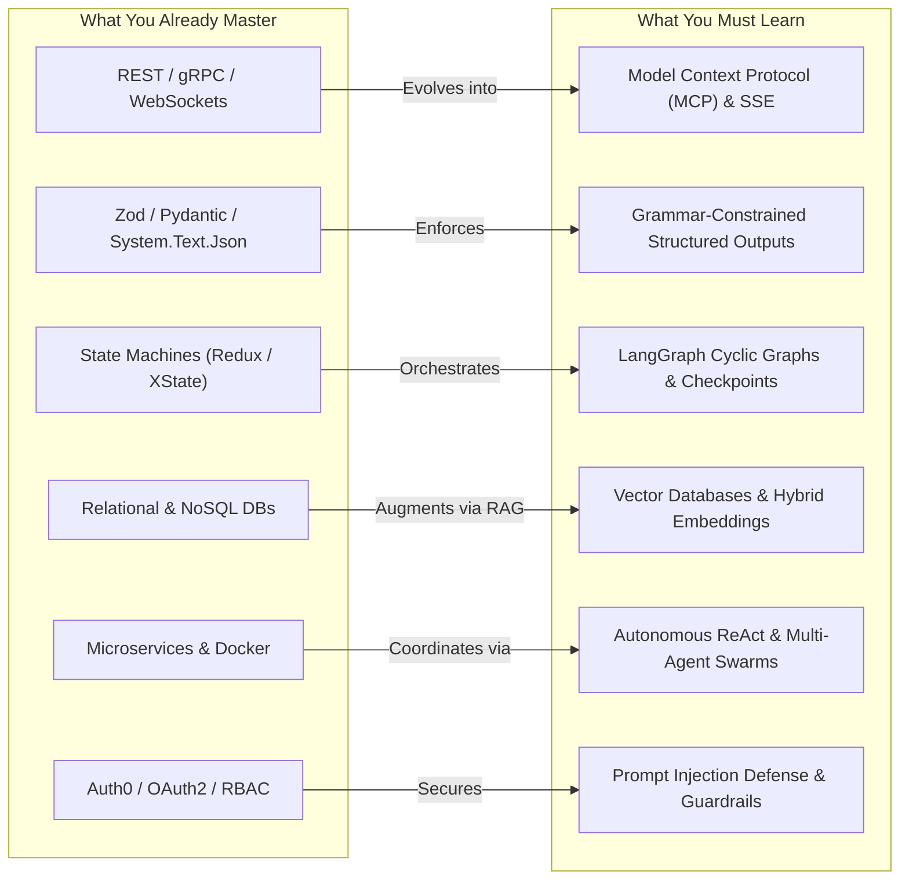
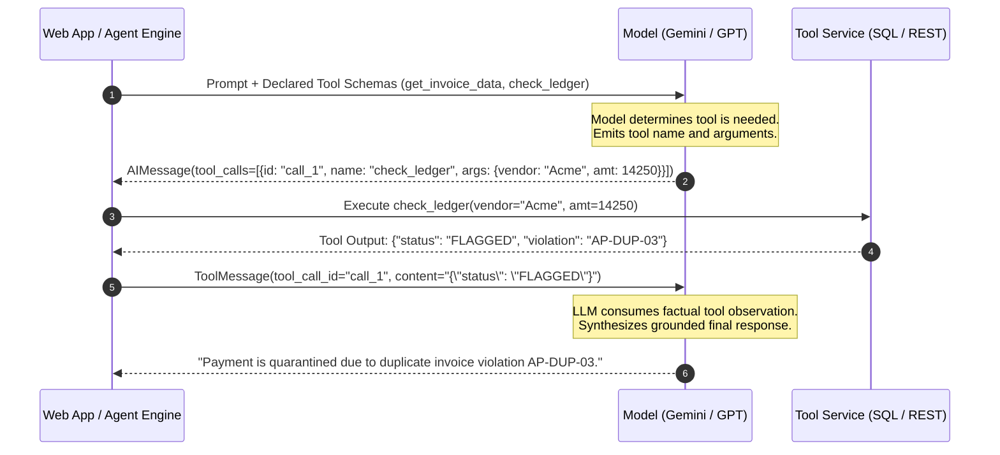
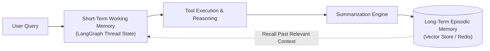
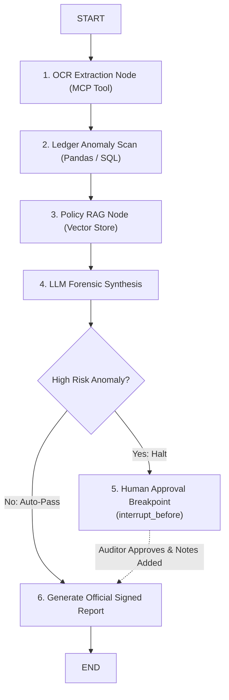
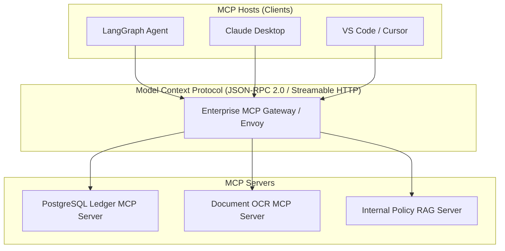
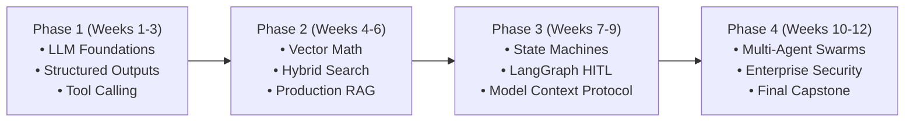

# Track 1: Agentic AI Roadmap for Experienced Web Developers

> **Target Audience:** Professional Software Engineers with experience in React, Angular, Node.js, TypeScript, C#, ASP.NET Core, and modern web architectures.  
> **Duration:** 12 Weeks (10–15 hours/week)  
> **Objective:** Transition from traditional deterministic web engineering to designing, building, and deploying enterprise-grade **Autonomous AI Agents, Multi-Agent Systems, and Model Context Protocol (MCP) Services**.

---

## 1. Skill Translation Matrix: What You Know vs. What You Need to Learn

As an experienced web or backend engineer, you already possess **80% of the software engineering discipline** required for AI systems (async execution, state management, HTTP/gRPC protocols, schema validation, data storage, and CI/CD). Your journey is not learning how to write loops—it is mastering how to **harness probabilistic neural reasoning within deterministic software architectures**.



### Detailed Concept Mapping

| Traditional Web Development Concept | AI & Agentic Engineering Equivalent | The Conceptual Shift |
| :--- | :--- | :--- |
| **Backend API Route / Controller** | **LLM System Prompt & Node Runner** | Instead of procedural code, you define high-level system instructions, constraints, and execution boundaries. |
| **Function / Service Method** | **Tool / Function Calling (MCP Tool)** | Functions are annotated with JSON schemas so the LLM brain can autonomously choose when and how to call them. |
| **Relational Database (SQL / EF Core)** | **Vector Database (pgvector, Qdrant, Chroma)** | Searching transitions from exact keyword/ID matching (`WHERE id = 5`) to mathematical semantic similarity in high-dimensional vector space. |
| **Redux / NgRx / Pinia State Store** | **Agent State / Blackboard (`AuditState`)** | State is held in a strongly typed dictionary that accumulates tool results, reasoning thoughts, and conversational turns across cycles. |
| **Middleware / Interceptors** | **Guardrails & Content Classifiers** | Intercepts prompts and tool outputs to block prompt injections, sensitive data leakage (PII), or unauthorized tool parameters. |
| **Background Cron Job / Worker Queue** | **Autonomous Agent Loop (ReAct / LangGraph)** | Rather than a fixed sequence of steps, an agent loop dynamically chooses the next action based on feedback from the prior tool call. |
| **Unit & Integration Testing** | **LLM-as-a-Judge & RAGAS Benchmarks** | Testing evolves from binary assertions (`assert expected == actual`) to statistical evaluations of semantic relevance, faithfulness, and precision. |
| **Application Logging (Serilog / Winston)** | **Tracing & Observability (LangSmith, OpenTelemetry)** | Logging visualizes full execution DAGs, prompt token consumption, latency per inference step, and LLM reasoning trajectories. |

---

## 2. Foundations: Generative AI, LLMs, and Agentic Workflows

### 2.1 The Paradigm Evolution

```mermaid
flowchart TD
    subgraph Level1 ["1. Traditional Deterministic Apps"]
        L1_Code["User Input"] --> L1_Proc["Procedural Code (if/else, SQL)"]
        L1_Proc --> L1_Out["Deterministic Output"]
    end

    subgraph Level2 ["2. AI-Powered Apps (Single-Turn)"]
        L2_Code["User Input"] --> L2_LLM["LLM API Call (Prompt + Context)"]
        L2_LLM --> L2_Out["Summarized / Generated Text"]
    end

    subgraph Level3 ["3. Agentic Applications (Autonomous Loop)"]
        L3_In["Goal / User Input"] --> L3_Agent["Agent Brain (Reasoning)"]
        L3_Agent --> L3_Plan["Formulate Multi-Step Plan"]
        L3_Plan --> L3_Tool["Execute Tools (APIs, DBs, Shell)"]
        L3_Tool --> L3_Obs["Observe Output & Reflect"]
        L3_Obs --> L3_Check{"Goal Complete or Need Approval?"}
        L3_Check -->|No| L3_Agent
        L3_Check -->|Approval Needed| L3_HITL["Human Auditor Sign-off"]
        L3_HITL --> L3_Agent
        L3_Check -->|Yes| L3_Out["Final Verified Deliverable"]
    end
```



1. **Traditional Applications:** Explicit logic. High reliability, zero semantic understanding of unstructured data (PDFs, images, free-form text).
2. **AI-Powered Applications (Augmented):** Single-turn LLM calls (e.g., text autocomplete, sentiment tagging). The model generates words but cannot act on the world.
3. **Agentic Applications (Autonomous & Goal-Driven):** The model operates in an active control loop:
   $$\text{Perceive} \longrightarrow \text{Reason / Plan} \longrightarrow \text{Act (Tool Call)} \longrightarrow \text{Observe} \longrightarrow \text{Iterate}$$
   Agents can query databases, execute code, verify intermediate results against policies, pause for human verification, and adapt to errors.

---

### 2.2 How LLMs Work: Core Mechanics for Backend Engineers

```
Raw Text: "Transfer $50,000 to vendor"
    │
    ▼ (Tokenizer: BPE / SentencePiece)
Tokens: ["Transfer", " $", "50", ",", "000", " to", " vendor"]  --> (Token IDs: [19420, 482, 3501, 11, ...])
    │
    ▼ (Embedding Layer + Positional Encoding)
Dense Vectors: Matrix of [Seq_Len, 4096] floats
    │
    ▼ (Transformer Decoder Attention Layers + KV Cache)
Logits: Probability distribution over ~128,000 vocabulary tokens
    │
    ▼ (Sampling: Temperature, Top-p, Min-p)
Next Predicted Token: " Cyber"
```

* **Tokens:** The fundamental atomic unit of LLMs. $\approx 4\text{ characters}$ or $0.75\text{ English words}$. Everything in AI (costs, rate limits, latency, context boundaries) is metered in tokens.
* **Context Window:** The active working memory buffer of the model (e.g., 128k in GPT-4o, 1M+ in Gemini 1.5/2.5 Pro). Compute scales with attention complexity; packing too many irrelevant tokens induces **"Lost in the Middle"** performance degradation.
* **Inference Stages:**
  * **Prefill Phase:** Computes the Key-Value (KV) cache for all prompt tokens in parallel. Compute-bound; determines **Time-to-First-Token (TTFT)**.
  * **Decode Phase:** Autoregressively generates one token at a time. Memory-bandwidth bound; determines **Inter-Token Latency (ITL)**.
* **Sampling Parameters:**
  * **Temperature ($T$):** Modifies the softmax logit distribution ($P(w_i) = \frac{\exp(z_i / T)}{\sum \exp(z_j / T)}$). For audit and data extraction, **always set $T = 0.0$** for deterministic argmax output.
  * **Top-$p$ (Nucleus):** Dynamically clips the sampling candidate pool to the smallest set of tokens whose cumulative probability exceeds $p$.
* **Hallucinations:** The model is a probabilistic completion engine, not a knowledge base. It emits words that are statistically plausible, not guaranteed to be factual. **Mitigation:** Grounding via Retrieval-Augmented Generation (RAG) and deterministic code verification tools (e.g., Pandas).

---

## 3. Prompt Engineering & Structured Outputs

### 3.1 Prompting Paradigms
- **Zero-Shot:** Instructing the model directly without examples.
- **Few-Shot:** Providing 2–5 concrete input/output demonstration exemplars within the system prompt to anchor style, tone, and edge-case handling.
- **Chain-of-Thought (CoT):** Directing the model to output intermediate reasoning steps (`"Think step-by-step before answering"`) to activate multi-hop attention layers prior to committing to a final answer.

### 3.2 Structured Outputs: From Strings to Type-Safe Contracts

In production web applications, raw markdown or unconstrained JSON strings are anti-patterns. You must enforce **Grammar-Constrained Decoding** using schemas.

#### TypeScript (Node.js) with Zod & OpenAI SDK
```typescript
import OpenAI from "openai";
import { z } from "zod";
import { zodResponseFormat } from "openai/helpers/zod";

const openai = new OpenAI();

// Define strict domain contract
const InvoiceSchema = z.object({
  vendor: z.string().describe("Legal entity name of the vendor"),
  invoiceNumber: z.string().describe("Unique invoice reference code"),
  date: z.string().describe("ISO 8601 date string"),
  amount: z.number().positive().describe("Total billing amount in USD"),
  lineItems: z.array(
    z.object({
      description: z.string(),
      quantity: z.number().int().positive(),
      unitPrice: z.number().positive(),
    })
  ),
  requiresDualApproval: z.boolean().describe("True if total amount exceeds $50,000"),
});

export type Invoice = z.infer<typeof InvoiceSchema>;

export async function parseInvoiceText(rawOcrText: string): Promise<Invoice> {
  const completion = await openai.beta.chat.completions.parse({
    model: "gpt-4o-2024-08-06",
    messages: [
      { role: "system", content: "Extract financial accounting entities into schema. Never guess fields." },
      { role: "user", content: rawOcrText },
    ],
    response_format: zodResponseFormat(InvoiceSchema, "invoice_extraction"),
    temperature: 0.0,
  });

  const parsed = completion.choices[0].message.parsed;
  if (!parsed) throw new Error("Failed to parse structured invoice.");
  return parsed;
}
```

#### C# (.NET 8/9) with Semantic Kernel / Azure OpenAI
```csharp
using System.Text.Json;
using System.Text.Json.Serialization;
using Microsoft.SemanticKernel;
using Microsoft.SemanticKernel.ChatCompletion;

public record InvoiceExtraction(
    [property: JsonPropertyName("vendor")] string Vendor,
    [property: JsonPropertyName("invoiceNumber")] string InvoiceNumber,
    [property: JsonPropertyName("amount")] decimal Amount,
    [property: JsonPropertyName("requiresDualApproval")] bool RequiresDualApproval
);

public class InvoiceParserService
{
    private readonly IChatCompletionService _chat;

    public InvoiceParserService(Kernel kernel)
    {
        _chat = kernel.GetRequiredService<IChatCompletionService>();
    }

    public async Task<InvoiceExtraction> ExtractInvoiceAsync(string rawOcrText)
    {
        var chatHistory = new ChatHistory("You are a financial extraction engine. Return strictly valid JSON.");
        chatHistory.AddUserMessage($"Extract the invoice fields from this text:\n{rawOcrText}");

        var promptSettings = new PromptExecutionSettings
        {
            ExtensionData = new Dictionary<string, object>
            {
                { "response_format", new { type = "json_object" } },
                { "temperature", 0.0 }
            }
        };

        var response = await _chat.GetChatMessageContentAsync(chatHistory, promptSettings);
        var json = response.Content ?? throw new InvalidOperationException("Empty response from model.");
        
        return JsonSerializer.Deserialize<InvoiceExtraction>(json, new JsonSerializerOptions { PropertyNameCaseInsensitive = true })!;
    }
}
```

---

## 4. Building Backend AI Services (Node.js & .NET)

Modern web apps require **Streaming Chunked Responses (Server-Sent Events - SSE)** so users do not stare at an empty spinner for 10 seconds while an LLM or multi-step agent runs.

### 4.1 Node.js / Express Streaming SSE Endpoint
```typescript
import express, { Request, Response } from "express";
import { GoogleGenerativeAI } from "@google/generative-ai";

const app = express();
const genAI = new GoogleGenerativeAI(process.env.GEMINI_API_KEY!);

app.post("/api/audit/stream", async (req: Request, res: Response) => {
  // Set headers for Server-Sent Events (SSE)
  res.setHeader("Content-Type", "text/event-stream");
  res.setHeader("Cache-Control", "no-cache");
  res.setHeader("Connection", "keep-alive");
  res.flushHeaders();

  try {
    const model = genAI.getGenerativeModel({ model: "gemini-1.5-flash" });
    const prompt = req.body.prompt;

    const result = await model.generateContentStream(prompt);

    for await (const chunk of result.stream) {
      const text = chunk.text();
      res.write(`data: ${JSON.stringify({ token: text })}\n\n`);
    }

    res.write(`data: ${JSON.stringify({ status: "DONE" })}\n\n`);
    res.end();
  } catch (error: any) {
    res.write(`data: ${JSON.stringify({ error: error.message })}\n\n`);
    res.end();
  }
});
```

### 4.2 ASP.NET Core Minimal API with `IAsyncEnumerable<T>`
```csharp
app.MapPost("/api/audit/stream", async (AuditRequest request, IChatCompletionService chatService, HttpContext context) =>
{
    context.Response.Headers.Append("Content-Type", "text/event-stream");
    context.Response.Headers.Append("Cache-Control", "no-cache");

    var history = new ChatHistory("Conduct forensic audit reasoning.");
    history.AddUserMessage(request.Prompt);

    await foreach (var messageChunk in chatService.GetStreamingChatMessageContentsAsync(history))
    {
        if (!string.IsNullOrEmpty(messageChunk.Content))
        {
            var data = JsonSerializer.Serialize(new { token = messageChunk.Content });
            await context.Response.WriteAsync($"data: {data}\n\n");
            await context.Response.Body.FlushAsync();
        }
    }

    await context.Response.WriteAsync("data: {\"status\": \"DONE\"}\n\n");
});
```

---

## 5. Building Frontend AI Interfaces (React & Angular)

### 5.1 React 18+ Streaming Chat Hook
```tsx
import React, { useState } from "react";

export function AuditChat() {
  const [messages, setMessages] = useState<Array<{ role: string; content: string }>>([]);
  const [input, setInput] = useState("");
  const [isStreaming, setIsStreaming] = useState(false);

  const sendMessage = async () => {
    if (!input.trim() || isStreaming) return;
    const userMsg = { role: "user", content: input };
    setMessages((prev) => [...prev, userMsg, { role: "assistant", content: "" }]);
    setInput("");
    setIsStreaming(true);

    const response = await fetch("/api/audit/stream", {
      method: "POST",
      headers: { "Content-Type": "application/json" },
      body: JSON.stringify({ prompt: input }),
    });

    const reader = response.body?.getReader();
    const decoder = new TextDecoder();
    if (!reader) return;

    while (true) {
      const { done, value } = await reader.read();
      if (done) break;

      const rawChunk = decoder.decode(value);
      const lines = rawChunk.split("\n\n").filter(Boolean);

      for (const line of lines) {
        if (line.startsWith("data: ")) {
          const payload = JSON.parse(line.replace("data: ", ""));
          if (payload.token) {
            setMessages((prev) => {
              const updated = [...prev];
              updated[updated.length - 1].content += payload.token;
              return updated;
            });
          }
        }
      }
    }
    setIsStreaming(false);
  };

  return (
    <div className="flex flex-col h-96 p-4 border rounded">
      <div className="flex-1 overflow-y-auto space-y-2">
        {messages.map((m, idx) => (
          <div key={idx} className={m.role === "user" ? "text-blue-600" : "text-gray-800"}>
            <strong>{m.role}:</strong> {m.content}
          </div>
        ))}
      </div>
      <div className="flex gap-2 mt-4">
        <input
          value={input}
          onChange={(e) => setInput(e.target.value)}
          onKeyDown={(e) => e.key === "Enter" && sendMessage()}
          placeholder="Ask auditor agent..."
          className="flex-1 border p-2 rounded"
        />
        <button onClick={sendMessage} disabled={isStreaming} className="bg-blue-600 text-white px-4 rounded">
          Send
        </button>
      </div>
    </div>
  );
}
```

### 5.2 Angular 17+ Signals & RxJS Comparison

In Angular 17+, you use **Signals** (`signal`, `computed`) coupled with an `Observable` reading the SSE stream via `fetch` or `EventSource`:
- **State:** Managed cleanly via `readonly messages = signal<ChatMessage[]>([]);`
- **Updates:** `this.messages.update(prev => [...])` triggers targeted DOM re-renders without zone.js overhead.
- **Control Flow:** Render using clean `@for (msg of messages(); track msg.id)` template syntax.

---

## 6. Function Calling & Tool Integration

Tool calling is the bridge between LLM intelligence and external computation:



### Node.js / TypeScript Tool Definition
```typescript
import { tool } from "@langchain/core/tools";
import { z } from "zod";

export const checkLedgerTool = tool(
  async ({ vendor, amount }: { vendor: string; amount: number }) => {
    // Deterministic database query
    const duplicate = await db.ledger.findFirst({
      where: { vendor, amount, createdAt: { gte: new Date(Date.now() - 72 * 3600 * 1000) } },
    });

    if (duplicate) {
      return JSON.stringify({
        status: "FLAGGED",
        violationCode: "AP-DUP-03",
        message: `Identical transaction found for vendor ${vendor} within 72 hours.`,
      });
    }
    return JSON.stringify({ status: "CLEAN", message: "No ledger anomalies detected." });
  },
  {
    name: "check_ledger_anomalies",
    description: "Queries historical accounts payable ledger for duplicate disbursements and threshold structuring.",
    schema: z.object({
      vendor: z.string().describe("Vendor business name"),
      amount: z.number().positive().describe("Disbursement amount in USD"),
    }),
  }
);
```

---

## 7. Retrieval-Augmented Generation (RAG) & Vector Databases

### 7.1 The End-to-End RAG Architecture

```mermaid
flowchart TD
    subgraph IngestionPhase ["Ingestion Pipeline (Offline / CDC)"]
        D1["Raw Documents (PDF, MD, Docx)"] --> D2["Layout Parser & Cleaner"]
        D2 --> D3["Chunker (Recursive Split: 500 tokens, 100 overlap)"]
        D3 --> D4["Embedding Model (text-embedding-3-small)"]
        D4 --> D5[("Vector DB (pgvector / Qdrant)")]
    end

    subgraph QueryPhase ["Retrieval & Generation Pipeline (Online)"]
        Q1["User Query"] --> Q2["Query Embedder"]
        Q2 --> Q3["Dense Vector Search (HNSW / Cosine)"]
        Q1 --> Q4["Sparse Keyword Search (BM25)"]
        Q3 --> Q5["Reciprocal Rank Fusion (RRF)"]
        Q4 --> Q5
        Q5 --> Q6["Cross-Encoder Re-ranker (Top 3)"]
        Q6 --> Q7["Prompt Assembly: Context + Question"]
        Q7 --> Q8["LLM Inference Engine"]
        Q8 --> Q9["Answer with Strict Source Citations"]
    end
```



### 7.2 Vector Math for Web Developers
A text embedding transforms unstructured language into a point in high-dimensional space ($\mathbb{R}^{1536}$):
- **Cosine Similarity:** Measures the cosine of the angle between query vector $\vec{q}$ and document vector $\vec{d}$:
  $$\text{CosineSim}(\vec{q}, \vec{d}) = \frac{\vec{q} \cdot \vec{d}}{\|\vec{q}\| \|\vec{d}\|}$$
- When vectors are unit-normalized ($\|\vec{q}\| = \|\vec{d}\| = 1$), cosine similarity simplifies to the basic dot product ($\vec{q} \cdot \vec{d}$).
- **Hybrid Search (BM25 + Dense Vectors with RRF):**
  Pure vector search fails on exact product SKUs, account IDs, or alphanumeric regulatory codes (`AP-DUP-03`). Modern RAG combines BM25 keyword rankings with dense vector rankings using **Reciprocal Rank Fusion (RRF)**:
  $$\mathrm{RRF}(d) = \sum_{m \in \{\text{dense}, \text{sparse}\}} \frac{1}{60 + \text{rank}_m(d)}$$

---

## 8. Agent Memory Systems

1. **Short-Term Memory (Scratchpad):** The working memory of the current LangGraph thread. Stores the immediate list of thoughts, tool requests, and tool returns within the current task execution.
2. **Conversational Memory:** Persists across multi-turn user dialogues. Managed using sliding token windows (`trim_messages`) or summary memory buffers.
3. **Long-Term Episodic Memory:** Stores user preferences, past project decisions, and historical resolutions across months. Backed by vector databases with entity metadata.



---

## 9. Agent Orchestration: LangGraph & Model Context Protocol (MCP)

### 9.1 LangGraph StateGraph Architecture



### 9.2 The Model Context Protocol (MCP)

**The Problem It Solves:** Connecting $M$ AI agents to $N$ enterprise data tools previously required $M \times N$ custom, proprietary integrations. MCP standardizes this into a single protocol ($M + N$).



* **Tools (Executable Actions):** `ocr_invoice`, `query_ledger_anomalies`.
* **Resources (Data Streams):** Identified by custom URIs: `audit://policies/sox404`.
* **Prompts (Reusable Templates):** Parameterized prompt workflows.
* **Transports:** `stdio` (local subprocess IPC for IDEs) and **Streamable HTTP** (modern remote transport with chunked transfer for web backends).

---

## 10. AI Application Security, Observability & FinOps

### 10.1 OWASP Top 10 for LLMs: Critical Mitigations
1. **Prompt Injection (Direct & Indirect):** Never concatenate untrusted third-party tool outputs into the system prompt. Enforce deterministic state gates (e.g., Pandas checks) that override LLM reasoning.
2. **Excessive Agency:** Never give an agent unconstrained write/delete permissions. Use Human-in-the-Loop (`interrupt_before`) on financial or destructive actions.
3. **Data Privacy (PII):** Use Microsoft Presidio to tokenize employee names, SSNs, and bank details before passing data to commercial LLM APIs.

### 10.2 Distributed Tracing & Observability
Use **LangSmith** or **OpenTelemetry** to instrument every agent node:
- **Spans:** Track duration and token costs per node (`node_ocr`, `node_rag`).
- **Trajectory Analysis:** Detect circular loops and runaway token burn.

### 10.3 FinOps & Cost Optimization
- **Model Tiering:** Use small, cheap models (e.g., `gemini-1.5-flash` at \$0.075/1M tokens) for $90\%$ of parsing and classification; route to frontier reasoning models (Gemini 1.5 Pro, GPT-4o) only for multi-hop synthesis.
- **Prefix Prompt Caching:** Identical system prompts and large static policy contexts are cached at the KV cache layer, slashing input costs by up to $80\%$.

---

## 11. The Progressive 12-Week Roadmap



### Weekly Learning Objectives & Hands-on Assignments

| Week | Focus Area | Core Learning Objective | Practical Hands-On Assignment |
| :---: | :--- | :--- | :--- |
| **W1** | **LLM Mechanics & APIs** | Master tokens, context windows, sampling ($T$, top-$p$), and SDK setup. | Build a CLI tool calling OpenAI and Gemini APIs; inspect token usage and latency. |
| **W2** | **Structured Outputs** | Enforce type-safe extraction using Zod / Pydantic. | Build a resume parsing microservice returning strict JSON schemas with zero regex hacks. |
| **W3** | **Function & Tool Calling** | Implement parallel tool calling and schema parameter binding. | Create an automated SQL Query Generator agent that queries a SQLite database and summarizes data. |
| **W4** | **Embeddings & Vector DBs** | Master vector geometry, Cosine Similarity, and pgvector. | Chunk and embed 50 corporate policy documents into pgvector; evaluate search recall. |
| **W5** | **Production RAG** | Implement recursive chunking, BM25 + dense hybrid search, and RRF. | Build a Documentation Search API with exact source citations and page numbers. |
| **W6** | **Advanced RAG & Re-ranking** | Apply Cross-Encoder re-rankers, HyDE, and contextual compression. | Add a Cohere/BGE re-ranker stage to reduce prompt distractors by $60\%$. |
| **W7** | **LangGraph State Machines** | Master `StateGraph`, TypedDict state, nodes, edges, and reducers. | Build a multi-step Customer Triage state machine with conditional branching in LangGraph. |
| **W8** | **Human-in-the-Loop (HITL)** | Implement breakpoints using `interrupt_before` and `MemorySaver`. | Build an order cancellation agent that halts and requires human manager approval. |
| **W9** | **Model Context Protocol (MCP)** | Build local and remote MCP servers exposing Tools and Resources. | Create an MCP server exposing enterprise database queries and test it in MCP Inspector. |
| **W10** | **Multi-Agent Systems** | Orchestrate Supervisor and Peer-to-Peer Swarm agent topologies. | Build a Code Review Team (Researcher Agent + Coder Agent + Security Auditor Agent). |
| **W11** | **Security & Observability** | Defend against prompt injections; trace agent execution in LangSmith. | Instrument an agent with OpenTelemetry; implement a DLP PII-masking middleware. |
| **W12** | **Production Capstone** | Deploy a resilient, scalable, full-stack agentic system with SSE & UI. | Complete and deploy the Enterprise Mini Audit Agent Capstone to the cloud. |

---

## 12. 5 Practical Portfolio Projects

### Project 1: Structured Entity Extraction Microservice
* **Stack:** Node.js / TypeScript, Express, Zod, React 18.
* **Architecture:** Ingests unstructured vendor emails or receipts, applies grammar-constrained decoding via Gemini/GPT, and outputs strongly typed accounting entities.
* **Key Challenge:** Zero validation failures even on ambiguous input formatting.

### Project 2: Enterprise Hybrid RAG Documentation Engine
* **Stack:** ASP.NET Core (.NET 8), pgvector, React, Tailwind CSS.
* **Architecture:** Ingests internal PDF standards. Uses recursive chunking, BM25 + dense vector hybrid search with Reciprocal Rank Fusion, and outputs Markdown with exact page citations.
* **Key Challenge:** Implementing Document-Level Security (DLS) so users only retrieve documents matching their JWT role.

### Project 3: Full-Stack Model Context Protocol (MCP) Suite
* **Stack:** TypeScript, FastMCP, Streamable HTTP, MCP Inspector.
* **Architecture:** Build an enterprise MCP Server exposing database operations (`query_ledger`, `get_customer_spend`) and static resources (`audit://compliance/rules`). Connect both Claude Desktop and a custom LangGraph agent to the same MCP server.
* **Key Challenge:** Securing the MCP server using OAuth 2.1 authorization codes.

### Project 4: Autonomous Customer Support Agent with HITL
* **Stack:** LangGraph (TypeScript/Python), FastAPI, Redis Checkpointer, Angular 17 UI.
* **Architecture:** ReAct agent equipped with CRM lookup, refund processing, and escalation tools. If a refund exceeds \$250, LangGraph triggers a breakpoint (`interrupt_before=["refund_node"]`), awaiting supervisor sign-off.
* **Key Challenge:** Seamlessly resuming state after 4 hours of human delay without losing thread history.

### Project 5 (Final Capstone): Autonomous Enterprise Forensic Audit Agent
* **Stack:** React 18 SPA + FastAPI + OpenCV Vision (CLAHE/Otsu) + Gemini Multimodal OCR + Pandas Anomaly Detection + Policy RAG + LangGraph + FastMCP + Server-Sent Events (SSE).
* **Architecture:** An end-to-end full-stack agentic system that audits incoming invoices against general ledgers:
  1. User uploads invoice image and ledger CSV via React UI.
  2. OpenCV preprocesses scan; Gemini OCR extracts structured fields.
  3. Pandas engine scans for duplicate billing (`AP-DUP-03`) and structuring (`AP-STRUCT-02`).
  4. Vector RAG retrieves governing accounting policies.
  5. LangGraph synthesizes evidence and pauses at a Human-in-the-Loop breakpoint.
  6. Progress is streamed live to the React UI via Server-Sent Events.
  7. Auditor reviews findings, enters notes, and clicks "Approve" to generate an official SOX 404 audit memorandum.

---

## 13. Common Mistakes & Best Practices

| Category | Common Anti-Pattern / Mistake | Production Best Practice |
| :--- | :--- | :--- |
| **Tool Calling** | Asking the LLM to do arithmetic calculations in its prompt. | **Delegate math to tools**: Write a deterministic Python/C# tool that calculates exact sums. |
| **RAG** | Dumping 50 raw retrieved chunks into a 128k context window. | **Re-rank & Compress**: Use a Cross-Encoder to filter down to the top 3–5 dense chunks. |
| **State Management** | Storing agent state in global mutable memory or browser session storage. | **Thread-Isolated Checkpointers**: Use `thread_id` backed by PostgreSQL (`PostgresSaver`) or Redis. |
| **Error Handling** | Letting tool execution exceptions crash the agent loop. | **Catch & Feedback**: Catch tool exceptions and return error messages as `ToolMessage` content so the LLM can self-correct. |
| **Security** | Allowing an agent to execute raw SQL or shell commands directly. | **Parameterized Micro-Sandboxes**: Restrict tools to parameterized APIs within read-only replicas or Firecracker containers. |
| **Prompting** | Writing 10-page monolithic prompts with contradictory instructions. | **Modular Personas**: Decompose monolithic prompts into specialized single-responsibility sub-agents. |

---

## 14. Recommended Tools & Official Documentation Links

* **Orchestration:** [LangChain](https://www.langchain.com/) | [LangGraph](https://langchain-ai.github.io/langgraph/) | [Microsoft Semantic Kernel](https://learn.microsoft.com/en-us/semantic-kernel/)
* **Protocols:** [Model Context Protocol (Official Docs)](https://modelcontextprotocol.io/) | [FastMCP](https://github.com/jlowin/fastmcp)
* **Observability:** [LangSmith](https://smith.langchain.com/) | [OpenTelemetry](https://opentelemetry.io/) | [Arize Phoenix](https://phoenix.arize.com/)
* **Vector Databases:** [pgvector](https://github.com/pgvector/pgvector) | [Qdrant](https://qdrant.tech/) | [Chroma](https://www.trychroma.com/)
* **Evaluation:** [RAGAS Framework](https://docs.ragas.io/) | [TruLens](https://www.trulens.org/)
