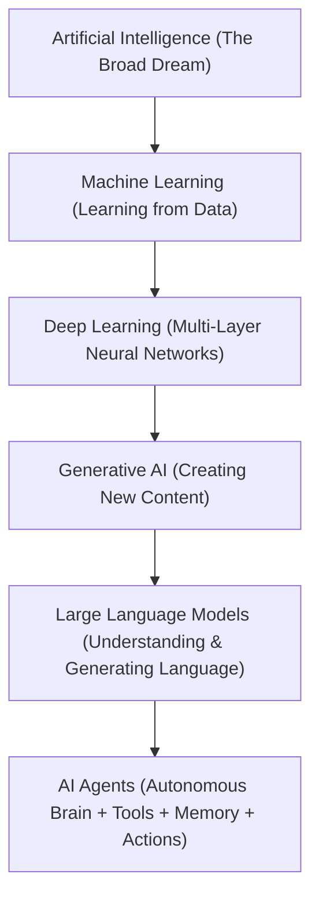
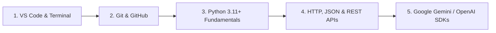
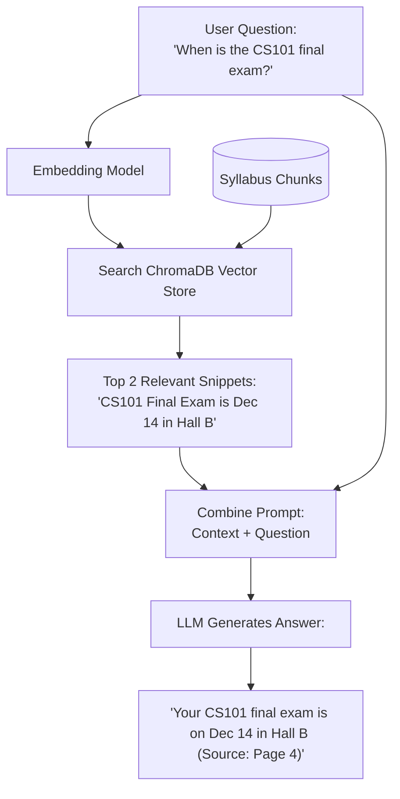
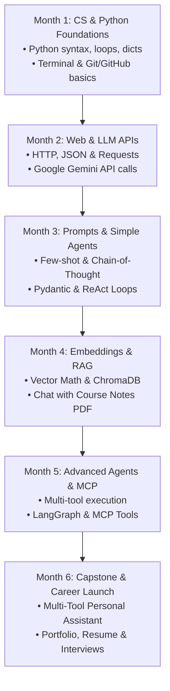

# Track 2: Agentic AI Roadmap for College Freshers & Beginners

> **Target Audience:** College students, fresh graduates, and coding beginners starting from zero or with basic programming knowledge.  
> **Duration:** 6 Months (10–12 hours/week)  
> **Primary Language:** Python 3.11+  
> **Objective:** Go from fundamental programming concepts to building, evaluating, and deploying real-world **AI Agents, RAG Applications, and Multi-Tool Assistants** to land internships and entry-level AI Engineering roles.

---

## 1. Demystifying the AI Hierarchy: Plain English with Real-Life Analogies

Before writing a single line of code, you must understand how the pieces of modern artificial intelligence fit together.



### 1. What is Artificial Intelligence (AI)?
* **Definition:** Any computer system designed to perform tasks that typically require human intelligence (e.g., recognizing objects, understanding speech, playing chess, or making decisions).
* **Real-Life Analogy:** Think of an umbrella. Under this umbrella are all methods—simple automated rules (like a calculator or automated traffic lights) and advanced learning models.

### 2. What is Machine Learning (ML)?
* **Definition:** Instead of a programmer writing strict rules (`if temperature > 100 then boil`), an ML algorithm is fed thousands of historical examples and figures out the mathematical patterns itself.
* **Real-Life Analogy:** Teaching a child to recognize dogs. You don't give the child a 500-page manual explaining dog ear angles and whisker lengths. You point to 50 dogs in the park and say *"Dog!"*. The child's brain learns the pattern.

### 3. What is Deep Learning (DL)?
* **Definition:** A specialized subfield of Machine Learning that uses **Artificial Neural Networks** with multiple layers (hence "deep") loosely inspired by how neurons in the human brain transmit electrical signals. Deep learning powers facial recognition, self-driving cars, and speech translation.

### 4. What is Generative AI (GenAI)?
* **Definition:** Traditional AI usually classified data (e.g., *"Is this email spam or not spam?"*). **Generative AI creates brand-new data** that resembles human creation—new text, images, music, or code.
* **Real-Life Analogy:** Traditional AI is an art critic judging whether a painting is a Picasso. Generative AI is the artist painting a brand-new masterpiece in the style of Picasso.

### 5. What is a Large Language Model (LLM)?
* **Definition:** A massive neural network trained on trillions of words from the public internet, books, and code. Its core mathematical objective is simple: **given a sequence of words, predict the most statistically probable next word**.
* **Real-Life Analogy:** Think of the autocomplete feature on your smartphone keyboard, but scaled up by millions of times with deep reasoning capabilities.
* Examples: OpenAI's GPT-4o, Google's Gemini, Anthropic's Claude, and Meta's open-source LLaMA.

### 6. What is an AI Agent?
* **Definition:** A standard LLM is a disembodied brain—it can talk, but it cannot do anything. An **AI Agent** takes that brain and equips it with:
  1. **Sensors / Perception:** The ability to receive user instructions, read files, or inspect web pages.
  2. **Tools / Hands:** The ability to execute real actions (search Google, query a SQL database, send an email, or run Python code).
  3. **Memory:** The ability to remember what happened three steps ago or recall user preferences from last week.
  4. **Planning Loop:** The autonomy to break a big goal into small steps and self-correct if a step fails.

### 7. What Makes an Application "Agentic"?
A traditional chatbot waits for your question, gives an answer, and stops. An **agentic application** works toward an end goal through an autonomous loop:

$$\text{Perceive} \longrightarrow \text{Plan / Reason} \longrightarrow \text{Take Action (Call Tool)} \longrightarrow \text{Inspect Result} \longrightarrow \text{Repeat Until Solved}$$

* **Real-Life Example:**
  * *Chatbot:* You ask, *"What's the weather in Tokyo, and can I fly there for under $800?"* The chatbot says, *"I don't have live internet data, but Tokyo is generally pleasant in spring."*
  * *AI Agent:* The agent realizes it lacks live data, calls a Weather API tool for Tokyo, calls a Flight Search API tool, checks calendar availability, and responds: *"Tokyo is currently 18°C. I found a flight for $740 on ANA leaving Friday. Should I book it?"*

---

## 2. The Core Technical Toolkit: From Zero to Developer

To build AI systems, you need a solid foundation in modern developer tools.



### 2.1 The Developer Environment Setup
1. **VS Code (Visual Studio Code):** The industry-standard code editor. Install extensions: `Python`, `Pylance`, `Black Formatter`, and `GitLens`.
2. **The Terminal / Command Line:** Learn essential commands:
   * Windows PowerShell: `cd` (change folder), `ls` or `dir` (list files), `mkdir` (make folder), `cls` (clear screen).
   * Mac/Linux: `cd`, `ls`, `mkdir`, `clear`, `pwd`.
3. **Git & GitHub (Your Public Portfolio):**
   * Git tracks changes in your code over time.
   * GitHub is the cloud platform where employers view your projects.
   * Core Git workflow:
     ```bash
     git init
     git add .
     git commit -m "feat: implement first AI tool"
     git branch -M main
     git remote add origin https://github.com/your-username/my-first-agent.git
     git push -u origin main
     ```

### 2.2 Python Fundamentals for AI Engineering
Python is the undisputed lingua franca of Artificial Intelligence due to its readability and rich ecosystem.

#### Must-Master Python Concepts:
* **Variables & Primitive Types:** `str`, `int`, `float`, `bool`.
* **Data Collections:** `list` (ordered items), `dict` (key-value pairs, vital for JSON payloads), `set` (unique items).
* **Control Flow:** `if / elif / else`, `for` loops, `while` loops.
* **Functions:** Defining reusable blocks with `def`, return values, and default arguments.
* **Virtual Environments (`venv`):** Never install packages globally. Always create an isolated sandbox for each project:
  ```bash
  python -m venv venv
  # Windows:
  venv\Scripts\activate
  # Mac/Linux:
  source venv/bin/activate
  ```
* **Object-Oriented Programming (OOP):** Understanding `class`, `self`, and methods.
* **Error Handling:** `try / except` blocks (essential because LLMs and network calls can fail).

### 2.3 Web Fundamentals: HTTP, JSON, and APIs
Every time an AI agent calls a tool or queries an LLM, it uses web protocols.
* **Client-Server Architecture:** Your Python script (Client) makes a request over the internet to Google or OpenAI's data centers (Server).
* **HTTP Methods:**
  * `GET`: Fetch data (e.g., read an article).
  * `POST`: Send data to be processed (e.g., send a prompt to an LLM).
* **JSON (JavaScript Object Notation):** The universal data language of AI. It looks almost identical to a Python dictionary:
  ```json
  {
    "user_id": 1042,
    "query": "Summarize policy",
    "temperature": 0.2,
    "tools_allowed": ["search_web", "query_db"]
  }
  ```

---

## 3. Working with LLM APIs & Prompt Engineering

### 3.1 Your First LLM API Call (Google Gemini Free Tier)
Google Gemini offers a generous free tier for developers, making it the ideal learning platform for college students.

```python
import os
from dotenv import load_dotenv
from google import genai

# 1. Load API key from local .env file (NEVER hardcode keys in code!)
load_dotenv()
api_key = os.getenv("GEMINI_API_KEY")

# 2. Initialize client
client = genai.Client(api_key=api_key)

# 3. Call the model
response = client.models.generate_content(
    model="gemini-2.5-flash",
    contents="Explain how an AI agent works to a 10-year-old in 3 bullet points."
)

print(response.text)
```

### 3.2 Prompt Engineering Mastery for Beginners
A prompt is your program for the LLM. Quality in = Quality out.

1. **System Prompt (The Persona & Rules):** Sets the ground rules before the user speaks.
   * Example: `"You are a strict code reviewer. Only point out security bugs and time-complexity issues. Keep answers under 100 words."`
2. **User Prompt (The Task):** The specific input or question.
3. **Few-Shot Prompting (Teaching by Example):**
   ```text
   Convert movie reviews into (Sentiment, Rating):
   Review: "The acting was wooden and the plot was boring." -> Sentiment: Negative, Rating: 2/10
   Review: "A cinematic masterpiece with breathtaking visuals!" -> Sentiment: Positive, Rating: 10/10
   Review: "The cinematography was great but it was 1 hour too long." -> Sentiment: Mixed, Rating: 6/10
   Review: "I fell asleep 20 minutes in." -> 
   ```
4. **Structured Outputs with Pydantic:**
   Instead of asking for text and hoping it gives you valid JSON, use **Pydantic** to enforce exact data schemas:
   ```python
   from pydantic import BaseModel, Field

   class MovieAnalysis(BaseModel):
       sentiment: str = Field(description="Must be Positive, Negative, or Mixed")
       rating_out_of_ten: int = Field(ge=1, le=10)
       primary_critique: str
   ```

---

## 4. Retrieval-Augmented Generation (RAG): Teaching the Model Your Data

### 4.1 The Problem with LLMs Alone
1. **Knowledge Cutoff:** An LLM only knows information up to its training date.
2. **Private Data Blindness:** An LLM does not know your personal notes, college syllabus, or company internal database.
3. **Hallucination:** When unsure, LLMs make up plausible-sounding fake facts.

**The Solution:** **RAG (Retrieval-Augmented Generation)**. Before asking the LLM to answer, you search your documents for the relevant facts and paste them into the prompt as reference material (like an open-book exam).



### 4.2 What is an Embedding?
* An embedding model turns a piece of text into a list of numbers (a vector) that captures its semantic meaning.
* Words with similar meanings end up close to each other in vector space:
  * `"King" - "Man" + "Woman" \approx "Queen"`
  * `"Dog"` is closer to `"Puppy"` than to `"Airplane"`.
* We measure distance using **Cosine Similarity** (angle between two arrows).

### 4.3 Building a Simple RAG Script with ChromaDB
```python
import chromadb

# 1. Initialize local in-memory vector database
chroma_client = chromadb.Client()
collection = chroma_client.create_collection(name="college_syllabus")

# 2. Add documents (Chroma automatically embeds text for you!)
collection.add(
    documents=[
        "CS101 Final Exam will take place on December 14 at 9:00 AM in Hall B.",
        "To pass the course, students must attend at least 75% of lab sessions.",
        "Office hours are held on Tuesdays from 2 PM to 4 PM in Room 302."
    ],
    ids=["doc1", "doc2", "doc3"]
)

# 3. Query the database using natural language
results = collection.query(
    query_texts=["When do I have to take the test?"],
    n_results=1
)

retrieved_context = results['documents'][0][0]
print(f"Retrieved Evidence: {retrieved_context}")

# 4. Pass evidence to LLM to produce answer
prompt = f"Answer the user's question using ONLY this fact:\nFact: {retrieved_context}\nQuestion: When is my exam?"
# (Send prompt to Gemini client...)
```

---

## 5. Building Your First AI Agent: Tools, Memory & Loops

### 5.1 How Function Calling Works
An agent doesn't possess magical powers; it simply emits structured JSON asking **your Python code** to execute a function on its behalf.

```python
# 1. Define a regular Python function (The Tool)
def get_crypto_price(coin_symbol: str) -> str:
    """Fetches the real-time price of a cryptocurrency."""
    prices = {"BTC": "$91,200", "ETH": "$3,450", "SOL": "$210"}
    return prices.get(coin_symbol.upper(), "Unknown coin symbol")

# 2. Declare tool schema to the Gemini client
# (The LLM inspects the docstring and parameter types, decides when to call it,
# returns the arguments, you execute get_crypto_price('BTC'), and send the result back)
```

### 5.2 The ReAct Loop (Reasoning + Acting)
The **ReAct** pattern is the foundational cognitive architecture of modern agents:
* **Thought:** Model reasons about what it knows and what it needs. (*"I need to know the price of Bitcoin before answering."*)
* **Action:** Model calls a tool. (*`call get_crypto_price(coin_symbol='BTC')`*)
* **Observation:** Model reads the tool output. (*`"$91,200"`*)
* **Thought:** Model evaluates if the goal is solved. (*"I now have the factual price."*)
* **Final Answer:** Model delivers the answer to the user.

---

## 6. The Structured 6-Month Learning Roadmap



### Month-by-Month Breakdown

#### Month 1: Computer Science & Python Foundations
* **Week 1:** Setup VS Code, Terminal basics, Python syntax, variables, arithmetic, print debugging.
* **Week 2:** Control structures (`if/else`), `for` and `while` loops, functions, parameter passing.
* **Week 3:** Python data structures: Lists, Dictionaries, Sets, Tuples, List comprehensions.
* **Week 4:** Git fundamentals: `git init`, `add`, `commit`, `push`, GitHub repositories, Markdown READMEs.
* **Milestone Assignment:** Build a CLI-based Task Manager in Python that saves tasks to a local `.txt` file and push it to GitHub.

#### Month 2: Web Fundamentals & Working with LLM APIs
* **Week 5:** Client-server model, HTTP verbs (GET, POST), status codes (200, 404, 500).
* **Week 6:** JSON parsing in Python with `import json`, calling public REST APIs using `requests`.
* **Week 7:** Environment variables with `.env`, obtaining a Google Gemini API key.
* **Week 8:** Making your first API calls, token counting, temperature experimentation.
* **Milestone Assignment:** Build a Weather & News CLI that calls an external weather API and uses Gemini to summarize the forecast.

#### Month 3: Prompt Engineering, Schemas & Basic Agents
* **Week 9:** Zero-shot vs. Few-shot prompt engineering; writing robust system prompts.
* **Week 10:** Chain-of-Thought prompting; preventing prompt injections and unwanted outputs.
* **Week 11:** Structured data generation using Pydantic; validating fields and types.
* **Week 12:** Building a manual ReAct loop in pure Python (no complex frameworks yet).
* **Milestone Assignment:** Build an automated Receipt Scanner CLI that extracts structured vendor, date, and price fields into Pydantic models.

#### Month 4: Embeddings, Vector Databases & RAG
* **Week 13:** What are embeddings? Mathematics of vector similarity (Cosine vs. Euclidean distance).
* **Week 14:** Document chunking strategies (fixed-size vs. recursive character splitting).
* **Week 15:** Setting up ChromaDB; indexing text chunks, querying top-$k$ nearest neighbors.
* **Week 16:** Building an end-to-end RAG pipeline: Ingestion $\rightarrow$ Retrieval $\rightarrow$ Prompt Assembly $\rightarrow$ Generation with citations.
* **Milestone Assignment:** Build "Chat with Your College Notes": Upload a course PDF and ask questions with exact page references.

#### Month 5: Advanced Agents, LangGraph & MCP
* **Week 17:** Moving beyond single tools: Multi-tool agents with parallel execution.
* **Week 18:** Introduction to LangGraph: Nodes, edges, and TypedDict state persistence.
* **Week 19:** Human-in-the-Loop (HITL): Halting an agent before sensitive actions.
* **Week 20:** Model Context Protocol (MCP): Understanding Host, Client, and Server architecture; running MCP Inspector.
* **Milestone Assignment:** Build an autonomous Research Agent that searches Wikipedia, takes notes in a SQLite database, and exports a Markdown report.

#### Month 6: Capstone Project, Portfolio & Career Launch
* **Week 21–22:** Build the Final Capstone: Autonomous Multi-Tool Personal Assistant.
* **Week 23:** Build an interactive frontend with **Streamlit**; deploy free on Streamlit Community Cloud.
* **Week 24:** Portfolio polish, GitHub README banners, technical resume preparation, and interview practice.

---

## 7. 5 Practical Portfolio Projects for Freshers

### Project 1: AI Flashcard & Quiz Generator
* **What It Does:** Takes raw student notes or a PDF chapter and automatically generates 10 multiple-choice questions with answer keys and explanations.
* **Skills Demonstrated:** Document parsing, prompt engineering, Pydantic structured outputs, Streamlit UI.

### Project 2: College Course & Internship Semantic Search
* **What It Does:** Ingests 500 internship descriptions. Instead of keyword searching, students search naturally: *"Remote python roles for someone who likes data analysis"*.
* **Skills Demonstrated:** Vector embeddings, ChromaDB, Cosine similarity, Top-$k$ retrieval.

### Project 3: Automated Market Research Agent
* **What It Does:** Given a company name (e.g., "Tesla" or "Nvidia"), the agent queries DuckDuckGo search, scrapes top articles, extracts key financial events, and writes an executive briefing.
* **Skills Demonstrated:** ReAct loop, tool integration, web scraping, error handling.

### Project 4: Conversational Expense Tracker with SQLite
* **What It Does:** User types: *"Spent $14 on burritos with Sarah"*. Agent calls an `add_expense(category="Food", amount=14.0, notes="with Sarah")` tool, records it in SQLite, and answers queries: *"How much have I spent on food this week?"*.
* **Skills Demonstrated:** Function calling, SQL database interaction, conversational memory.

### Project 5 (Final Capstone): Autonomous Multi-Tool Personal Assistant
* **Architecture:**
  * **Brain:** Gemini 2.5 Flash with LangGraph state machine.
  * **Tools:**
    1. `search_web(query)`: DuckDuckGo live search.
    2. `manage_calendar(action, date, title)`: Read/write to local calendar database.
    3. `query_notes_rag(question)`: Semantic search over user's uploaded personal documents.
    4. `execute_calculator(expression)`: Deterministic mathematical evaluation.
  * **UI:** Clean, interactive web interface built with Streamlit.
  * **Deployment:** Hosted live on Streamlit Community Cloud with a demo video on LinkedIn.

---

## 8. Career Launchpad: How to Land Your First AI Role

### 8.1 Building a Standout GitHub Portfolio
Recruiters and engineering managers do not care about certificates; they care about **working software**.
1. **The Pinned Repository Rule:** Pin your 3 best AI projects on your GitHub profile.
2. **Every Project Must Have:**
   * A clean, descriptive `README.md` with an architecture diagram.
   * A 30-second animated GIF or video walkthrough showing the agent working.
   * One-click run instructions (`pip install -r requirements.txt`, `python main.py`).
   * A working live demo link (Streamlit / Hugging Face).

### 8.2 Resume Architecture for Freshers
* **Headline:** *"Aspiring AI Engineer \| Python, LangGraph, RAG & Agentic Systems"* (not just "Student").
* **Section Order:**
  1. **Technical Skills:** Languages (Python), AI Frameworks (LangGraph, Gemini SDK, ChromaDB), Tools (Git, VS Code, Docker, Linux).
  2. **AI Projects (The Core):** Use the Google **XYZ Formula**: *"Accomplished [X], as measured by [Y], by doing [Z]"*.
     * *Example:* *"Architected an autonomous research agent using LangGraph and ChromaDB that reduced document review time by 75% across 200 college PDF standards."*
  3. **Education:** Degree, Major, GPA (if $>3.5$), Graduation Year.

### 8.3 Top 10 Entry-Level AI Engineering Interview Questions
1. *What is the difference between an embedding and a traditional text search?*
2. *Why do we use ChromaDB or vector databases instead of standard PostgreSQL for semantic search?*
3. *What is a token, and why do LLMs struggle with 5-digit multiplication?*
4. *What happens under the hood during a tool call (function call)?*
5. *What is chunk overlap in RAG, and why is it important?*
6. *What is the difference between temperature 0.0 and temperature 1.0?*
7. *How does the ReAct agent loop decide when to stop?*
8. *What is prompt injection, and how would you prevent a user from hacking your agent?*
9. *What is the difference between short-term thread memory and long-term vector memory?*
10. *Why do we use Pydantic models with LLM APIs?*

---

## 9. Curated Free Learning Resources

* **Python Fundamentals:**
  * [Python.org Official Tutorial](https://docs.python.org/3/tutorial/) (Free)
  * [Automate the Boring Stuff with Python by Al Sweigart](https://automatetheboringstuff.com/) (Free online book)
* **Git & Version Control:**
  * [GitHub Skills Interactive Tutorials](https://skills.github.com/) (Free)
* **Generative AI & LLMs:**
  * [Google DeepMind Generative AI Short Courses](https://www.deeplearning.ai/) (Free short courses with Andrew Ng)
  * [Google Gemini API Documentation & Quickstarts](https://ai.google.dev/gemini-api/docs) (Free tier available)
* **Agentic AI & Vector Search:**
  * [LangChain & LangGraph Academy](https://academy.langchain.com/) (Free official video tutorials)
  * [ChromaDB Getting Started Guide](https://docs.trychroma.com/)
  * [Model Context Protocol Quickstarts](https://modelcontextprotocol.io/quickstart)
