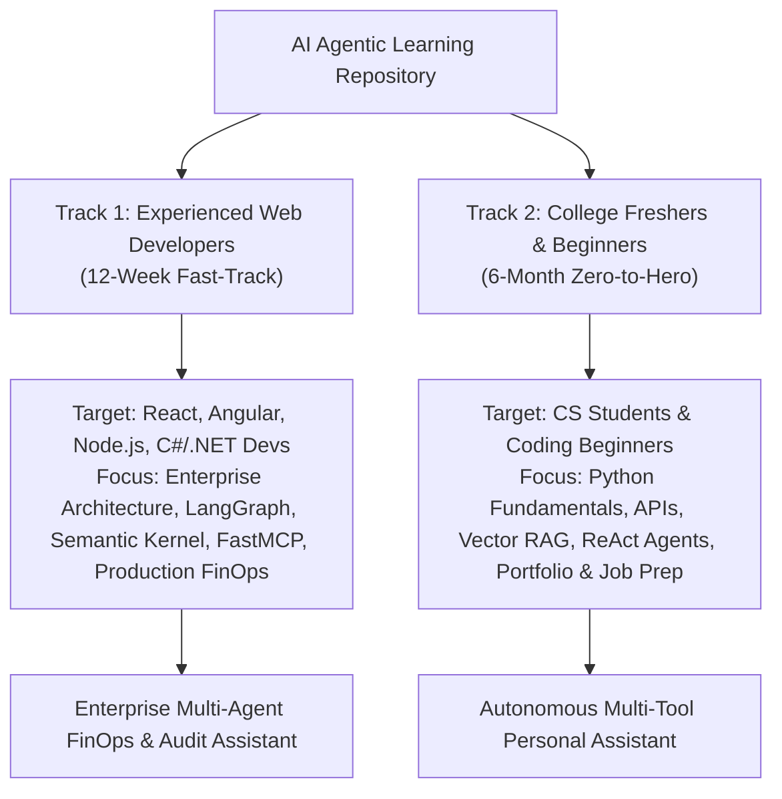

# AI Agentic Application Development: Comprehensive Master Learning Roadmaps

Welcome to the **AI Agentic Application Development Learning Repository**. This repository contains production-oriented, pedagogically rigorous roadmaps designed to guide engineers and aspiring technologists from the foundations of Generative AI to designing, building, orchestrating, and deploying enterprise-grade **Autonomous AI Agents and Multi-Agent Workflows**.

---

## 1. What This Learning Repository Is About

The software engineering landscape is experiencing a generational architectural transition:
- **Traditional Applications (Deterministic):** Code paths are hardcoded using explicit conditional statements (`if/else`), relational databases, and static procedural logic. The system does only what was explicitly anticipated.
- **AI-Powered Applications (Augmented):** Deterministic systems augmented with Large Language Models (LLMs) via single-turn API calls (e.g., semantic summarization, sentiment analysis, simple document Q&A).
- **Agentic AI Applications (Autonomous & Goal-Driven):** Systems where an LLM serves as a central reasoning and planning "brain" that operates in an autonomous loop: **Perceive $\rightarrow$ Reason / Plan $\rightarrow$ Act (Call Tools) $\rightarrow$ Observe Feedback $\rightarrow$ Reflect & Adapt $\rightarrow$ Conclude**. These systems maintain state, read from dynamic external resources, coordinate with other specialized agents, and interact with the physical and digital world through standardized protocols like the **Model Context Protocol (MCP)**.

This repository provides two specialized, full-depth curriculum paths tailored to distinct technical backgrounds and timelines.

---

## 2. The Two Learning Tracks

### Track 1: Experienced Web Developers (12 Weeks)
* **File:** [`01-agentic-ai-roadmap-for-web-developers.md`](./01-agentic-ai-roadmap-for-web-developers.md)
* **Target Audience:** Professional software engineers with 1–8+ years of experience in JavaScript/TypeScript (React, Angular, Node.js, Express/NestJS) or C#/.NET (ASP.NET Core, Web APIs, EF Core).
* **Pedagogical Strategy:** Bridges existing architectural knowledge (REST APIs, WebSockets, state machines, middleware, dependency injection, microservices) into agentic concepts (Tool Calling, Vector RAG, Memory Checkpointers, LangGraph, Semantic Kernel, Model Context Protocol, and Evaluation Observability).
* **Primary Languages & Stacks:** TypeScript (Node.js), C# (.NET 8/9), React, Angular, LangGraph.js / LangGraph Python, Microsoft Semantic Kernel, FastMCP.

### Track 2: College Freshers & CS Students (6 Months)
* **File:** [`02-agentic-ai-roadmap-for-college-freshers.md`](./02-agentic-ai-roadmap-for-college-freshers.md)
* **Target Audience:** College students, self-taught beginners, and fresh graduates with basic or zero coding experience who want to break into AI Engineering and Agentic Application Development.
* **Pedagogical Strategy:** Assumes no prior professional background. Builds ground-up intuition starting from computer science fundamentals, Python programming, Git/GitHub, HTTP/JSON, vector math, and step-by-step agentic implementations using modern SDKs.
* **Primary Languages & Stacks:** Python 3.11+, Streamlit/FastAPI, Google Gemini API, LangChain/LangGraph, ChromaDB, SQLite.

---

## 3. Comparative Matrix: Which Path Should You Choose?

| Dimension | Track 1: Experienced Web Developers | Track 2: College Freshers & Beginners |
| :--- | :--- | :--- |
| **Document** | [`01-agentic-ai-roadmap-for-web-developers.md`](./01-agentic-ai-roadmap-for-web-developers.md) | [`02-agentic-ai-roadmap-for-college-freshers.md`](./02-agentic-ai-roadmap-for-college-freshers.md) |
| **Target Timeline** | **12 Weeks** (10–15 hours/week) | **6 Months** (10–12 hours/week) |
| **Prerequisites** | HTML/CSS, JS/TS or C#, REST APIs, Git, relational databases | High school math, basic logic, curiosity (zero prior coding required) |
| **Primary Languages** | TypeScript (Node.js) & C# (.NET 8/9) | Python 3.11+ (HTML/JS introduced later) |
| **Frontend Paradigms** | React 18+ (Hooks, Context, SSE) & Angular 17+ (Signals, RxJS) | Streamlit (Python UI) $\rightarrow$ React SPA basics |
| **Agentic Frameworks** | LangGraph, Microsoft Semantic Kernel, Microsoft Agent Framework | LangGraph, LangChain, Google GenAI SDK |
| **Protocol Focus** | Model Context Protocol (MCP) in-depth, JSON-RPC 2.0, Streamable HTTP | MCP fundamentals, Tool calling, REST APIs |
| **Math & Theory Depth** | Applied embeddings math, Cosine/Dot product, Attention complexities, KV cache | Visual/intuitive explanations, Euclidean distance, embeddings as coordinates |
| **Enterprise Focus** | OWASP LLM Top 10, Prompt injection defense, Distributed tracing, FinOps, SLAs | Clean coding, Git best practices, Interview preparation, Resume projects |
| **Final Capstone** | Production-ready Enterprise Multi-Agent System with Human-in-the-Loop & MCP | Autonomous Multi-Tool Personal Task & Research Assistant |
| **Career Outcome** | Senior AI Engineer, Agentic Solutions Architect, Full-Stack AI Lead | Associate AI Engineer, Junior Python Developer, GenAI Intern |

---

## 4. Recommended Reading Order & Study Strategy

1. **Self-Assessment:**
   - If you already write production backends (Node.js, ASP.NET Core) or frontends (React, Angular), jump straight to [`01-agentic-ai-roadmap-for-web-developers.md`](./01-agentic-ai-roadmap-for-web-developers.md).
   - If you are in college, transitioning from a non-technical field, or learning to code, start with [`02-agentic-ai-roadmap-for-college-freshers.md`](./02-agentic-ai-roadmap-for-college-freshers.md).
2. **Build as You Read:**
   - Agentic AI is an empirical discipline. Do not treat these documents as passive reading material. Every section includes concrete assignments, coding challenges, and portfolio projects. Clone the repositories, run the scripts, inspect network frames, and break things intentionally to observe failure modes.
3. **Stay Up-to-Date:**
   > [!IMPORTANT]
   > The Generative AI and Agentic ecosystem moves rapidly. Library APIs (LangChain, LangGraph, Semantic Kernel, FastMCP) frequently release updates. Always consult the official documentation links provided in each guide to verify latest syntax while retaining the durable architectural patterns taught here.

---

## 5. Master Roadmap Links

* 📘 **[Track 1: Agentic AI Roadmap for Experienced Web Developers (12 Weeks)](./01-agentic-ai-roadmap-for-web-developers.md)**
* 📗 **[Track 2: Agentic AI Roadmap for College Freshers & Beginners (6 Months)](./02-agentic-ai-roadmap-for-college-freshers.md)**

---

## 6. Comprehensive Interview Question Bank & Knowledge Base

For technical interview preparation, hiring evaluations, and deep conceptual mastery, explore the **[AI Agentic Question Bank](./question-bank/README.md)** featuring **250+ technical questions across 5 difficulty levels**, complete with 7-part answers, coding challenges, and system design blueprints:

* 📚 **[Master Question Bank Directory & Index](./question-bank/README.md)**
* 🧠 **[Block A: LLM Fundamentals Q&A (35 Q&As)](./question-bank/block-a-llm-fundamentals-qna.md)**
* 🔍 **[Block B: RAG Mastery Q&A (35 Q&As)](./question-bank/block-b-rag-mastery-qna.md)**
* 🕸️ **[Block C: LangChain & LangGraph Q&A (35 Q&As)](./question-bank/block-c-langchain-langgraph-qna.md)**
* 🤖 **[Block D: Agentic AI & Autonomy Q&A (35 Q&As)](./question-bank/block-d-agentic-ai-qna.md)**
* 🔌 **[Block E: Model Context Protocol (MCP) Q&A (35 Q&As)](./question-bank/block-e-mcp-protocol-qna.md)**
* 🎯 **[Capstone: Mini Audit Agent Q&A (35 Q&As)](./question-bank/capstone-mini-audit-agent-qna.md)**
* 💼 **[Consolidated Interview Preparation Guide](./question-bank/interview-preparation.md)**
* 💻 **[Practical Coding Challenges & Reference Solutions](./question-bank/coding-challenges.md)**
* 🏗️ **[Enterprise System Design Architecture Scenarios](./question-bank/system-design-scenarios.md)**

---

*Authored by Senior AI Architects, Technical Curriculum Designers, and Documentation Specialists for the Global Developer Community.*
