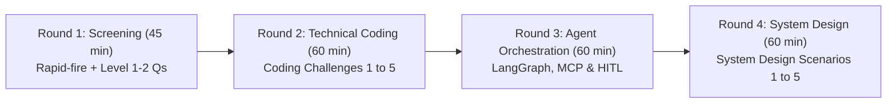

# AI Agentic Application Development — Master Question Bank & Knowledge Base

> An enterprise-grade, comprehensive interview preparation and technical assessment knowledge base covering the end-to-end AI Agentic curriculum. Contains **250+ in-depth questions and answers**, practical coding challenges, and production system design blueprints.

---

## Structure of the Question Bank

Every curriculum block is accompanied by a dedicated, deeply technical Question & Answer file spanning **5 progressive difficulty levels** and utilizing a **7-part answer methodology**:

```
[Level 1: Absolute Beginner]  --> What is it? Why is it needed? Everyday analogies.
[Level 2: Beginner]           --> Core mechanics, terminology, basic implementation.
[Level 3: Intermediate]       --> Practical code, trade-offs, debugging, scenario analysis.
[Level 4: Advanced]           --> Internals, performance, reliability, security vulnerabilities.
[Level 5: Real-World Expert]  --> Distributed systems, cost/latency budgets, production incidents.
```

### The 7-Part Answer Standard
To ensure production relevance, every answer follows this structured blueprint:
1. **Direct Answer**: Concise, unambiguous technical definition.
2. **Underlying Concept**: Theoretical foundation and mechanical underpinnings.
3. **Practical Example**: Realistic business scenario.
4. **Code Example**: Executable code in Python, TypeScript/Node.js, C#/.NET, React, or Angular.
5. **Real-World Application**: Enterprise use case (finance, legal, software, healthcare).
6. **Common Mistakes**: Frequent engineering pitfalls and debugging warnings.
7. **Follow-up Interview Question**: The next question a principal engineer or hiring manager will probe.

---

## Master Directory & Topic Coverage Index

| Document | Curriculum Block | Primary Focus & Tech Stack | Level Distribution | Questions |
| :--- | :--- | :--- | :--- | :--- |
| [block-a-llm-fundamentals-qna.md](file:///C:/Users/COM/Desktop/sample/genai-agentic-curriculum/docs/question-bank/block-a-llm-fundamentals-qna.md) | **Block A: LLM Fundamentals** | BPE Tokenizers, Transformer Attention, Quantization (GGUF/AWQ), Structured JSON Outputs, Prompt Defense | L1 to L5 | 35 Q&As |
| [block-b-rag-mastery-qna.md](file:///C:/Users/COM/Desktop/sample/genai-agentic-curriculum/docs/question-bank/block-b-rag-mastery-qna.md) | **Block B: RAG Mastery** | Vector Math (Cosine/Dot), Semantic Chunking, Hybrid Search (Dense + BM25), Reciprocal Rank Fusion, Cross-Encoder Reranking, DLS | L1 to L5 | 35 Q&As |
| [block-c-langchain-langgraph-qna.md](file:///C:/Users/COM/Desktop/sample/genai-agentic-curriculum/docs/question-bank/block-c-langchain-langgraph-qna.md) | **Block C: LangChain & LangGraph** | StateGraph, Reducers, Checkpointers (Postgres/Redis), Human-in-the-Loop (`interrupt`), Cyclic Workflows, Time Travel | L1 to L5 | 35 Q&As |
| [block-d-agentic-ai-qna.md](file:///C:/Users/COM/Desktop/sample/genai-agentic-curriculum/docs/question-bank/block-d-agentic-ai-qna.md) | **Block D: Agentic AI** | Autonomy Levels (L0–L5), ReAct Pattern, Plan-and-Execute, Multi-Agent Swarms, SOX 404 Auditability, A2A Protocol | L1 to L5 | 35 Q&As |
| [block-e-mcp-protocol-qna.md](file:///C:/Users/COM/Desktop/sample/genai-agentic-curriculum/docs/question-bank/block-e-mcp-protocol-qna.md) | **Block E: Model Context Protocol** | JSON-RPC 2.0, Tools, Resources, Prompts, FastMCP, Streamable HTTP vs Stdio, OAuth 2.1, Tool Poisoning & Security | L1 to L5 | 35 Q&As |
| [capstone-mini-audit-agent-qna.md](file:///C:/Users/COM/Desktop/sample/genai-agentic-curriculum/docs/question-bank/capstone-mini-audit-agent-qna.md) | **Capstone: Mini Audit Agent** | React SPA, FastAPI Backend, OpenCV Image Preprocessing, Tesseract OCR, Pandas Ledger Anomaly Detection, SSE Streaming | L1 to L5 | 35 Q&As |
| [interview-preparation.md](file:///C:/Users/COM/Desktop/sample/genai-agentic-curriculum/docs/question-bank/interview-preparation.md) | **Interview Preparation Guide** | 4-Round Interview Anatomy, Audience Study Paths (Track 1 & 2), 15 Rapid-Fire Questions, 10 Tricky Questions, Behavioral Guides | All Levels | Guide + 25 Q&As |
| [coding-challenges.md](file:///C:/Users/COM/Desktop/sample/genai-agentic-curriculum/docs/question-bank/coding-challenges.md) | **Practical Coding Challenges** | 7 End-to-End Live Coding Problems with Complete Production Solutions (Python & TypeScript/C#) | Easy to Expert | 7 Complete Challenges |
| [system-design-scenarios.md](file:///C:/Users/COM/Desktop/sample/genai-agentic-curriculum/docs/question-bank/system-design-scenarios.md) | **System Design Blueprints** | 5 Enterprise Architecture Blueprints: 1M Invoices/Day Audit, 10M Doc Legal RAG, Centralized MCP Gateway, Multi-Agent SWE, Real-Time Voice | Architect / Principal | 5 Full Blueprints |

---

## Learning Paths by Audience

### Track 1: Experienced Web Developers (TypeScript, C#/.NET, React, Angular)
If you are transitioning from full-stack or backend enterprise engineering to AI Engineering:
1. **Start with Block C & Block E**: Map your existing understanding of state machines (Redux/XState) and microservice protocols (REST/gRPC) to **LangGraph** and **MCP**.
2. **Master Function Calling & Structured Outputs** in [block-a-llm-fundamentals-qna.md](file:///C:/Users/COM/Desktop/sample/genai-agentic-curriculum/docs/question-bank/block-a-llm-fundamentals-qna.md#level-3--intermediate).
3. **Study Production Guardrails & Security**: Review prompt injection prevention, tool authorization (OPA), and confused deputy mitigation in [block-e-mcp-protocol-qna.md](file:///C:/Users/COM/Desktop/sample/genai-agentic-curriculum/docs/question-bank/block-e-mcp-protocol-qna.md) and [system-design-scenarios.md](file:///C:/Users/COM/Desktop/sample/genai-agentic-curriculum/docs/question-bank/system-design-scenarios.md#scenario-3-centralized-enterprise-model-context-protocol-mcp-gateway).
4. **Complete Coding Challenges 3, 4, 6, and 7** in [coding-challenges.md](file:///C:/Users/COM/Desktop/sample/genai-agentic-curriculum/docs/question-bank/coding-challenges.md).

### Track 2: College Students & Freshers (Python, AI/ML Beginners)
If you are learning modern AI engineering from first principles:
1. **Follow the Curriculum Sequentially**: Block A $\rightarrow$ Block B $\rightarrow$ Block C $\rightarrow$ Block D $\rightarrow$ Block E $\rightarrow$ Capstone.
2. **Prioritize Level 1 and Level 2 Questions**: Build solid mental models of tokens, embeddings, vector similarity, and basic agent loops before attempting multi-agent swarms.
3. **Practice Hands-On Coding**: Implement [coding-challenges.md](file:///C:/Users/COM/Desktop/sample/genai-agentic-curriculum/docs/question-bank/coding-challenges.md) starting from Challenge 1 (Cosine Similarity & Dense Search) and Challenge 2 (Deterministic Agent Loop).
4. **Study Interview Preparation**: Review the 15 rapid-fire questions in [interview-preparation.md](file:///C:/Users/COM/Desktop/sample/genai-agentic-curriculum/docs/question-bank/interview-preparation.md) to build confidence for technical screening rounds.

---

## How Interviewers Should Use This Question Bank

This repository provides ready-to-use assessment material across all 4 stages of modern AI engineering hiring:



- **Round 1 (Phone Screen / Fundamental Assessment)**:
  - Pick 5 questions from Level 2 of Block A and Block B.
  - Probe understanding of tokenization, vector search trade-offs, and structured outputs.
- **Round 2 (Live Coding & Algorithmic Implementation)**:
  - Select Challenge 2 (ReAct Agent Loop) or Challenge 4 (Custom Reciprocal Rank Fusion) from [coding-challenges.md](file:///C:/Users/COM/Desktop/sample/genai-agentic-curriculum/docs/question-bank/coding-challenges.md).
  - Verify clean state handling, exception catching, and deterministic output schema validation.
- **Round 3 (System Architecture & Agent Orchestration)**:
  - Probe candidate on LangGraph state persistence, reducers, and human-in-the-loop interrupts using questions from [block-c-langchain-langgraph-qna.md](file:///C:/Users/COM/Desktop/sample/genai-agentic-curriculum/docs/question-bank/block-c-langchain-langgraph-qna.md) and [block-d-agentic-ai-qna.md](file:///C:/Users/COM/Desktop/sample/genai-agentic-curriculum/docs/question-bank/block-d-agentic-ai-qna.md).
- **Round 4 (Principal System Design & Governance)**:
  - Present one of the 5 case studies from [system-design-scenarios.md](file:///C:/Users/COM/Desktop/sample/genai-agentic-curriculum/docs/question-bank/system-design-scenarios.md) (e.g., Enterprise Audit Platform or Centralized MCP Gateway).
  - Evaluate trade-offs in multi-tenancy, model tiering, failure modes, and compliance (SOX/GDPR).

---

## Related Documentation & Learning Roadmaps

- [01-agentic-ai-roadmap-for-web-developers.md](file:///C:/Users/COM/Desktop/sample/genai-agentic-curriculum/docs/01-agentic-ai-roadmap-for-web-developers.md) — 12-Week Progressive Roadmap for Experienced Engineers.
- [02-agentic-ai-roadmap-for-college-freshers.md](file:///C:/Users/COM/Desktop/sample/genai-agentic-curriculum/docs/02-agentic-ai-roadmap-for-college-freshers.md) — 6-Month Structured Foundations Roadmap for Freshers.
- [Main Curriculum Documentation Index](file:///C:/Users/COM/Desktop/sample/genai-agentic-curriculum/docs/README.md) — Overview of the Dual-Track Curriculum.
