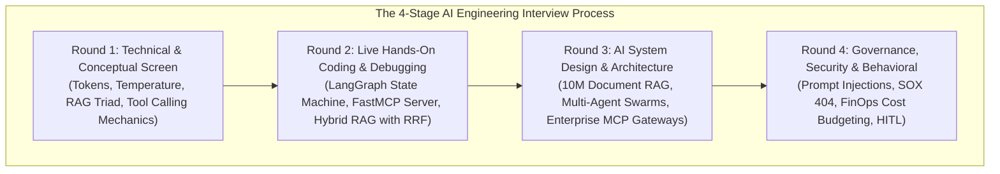
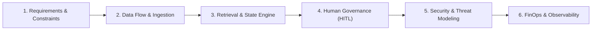

# Consolidated AI Engineering Interview Preparation Guide

> **Target Audience:** Engineering Candidates preparing for AI Engineer, Agentic AI Architect, LLM Application Developer, and Full-Stack GenAI roles.  
> **Applicable Tracks:** Track 1 (Experienced Web & .NET Developers) and Track 2 (College Freshers & Transitioning Engineers).

---

## 1. The Anatomy of Modern AI Engineering Interviews

The era of generic data structures and binary tree inversions is shifting. Leading tech companies, enterprises, and AI startups evaluate candidates across four distinct dimensions:

### The 4 Core Interview Pillars
1. **Pillar 1: Probabilistic vs. Deterministic Boundaries:**
   Do you know when *not* to use an LLM? (e.g., using Pandas for exact math and vector databases for semantic search).
2. **Pillar 2: State & Tool Orchestration:**
   Can you design cyclic state machines (LangGraph) with persistence, human approval breakpoints, and decoupled tool servers (MCP)?
3. **Pillar 3: Retrieval Quality & Evaluation:**
   Do you know how to benchmark a RAG pipeline using RAGAS, and can you combine sparse BM25 and dense vector search via Reciprocal Rank Fusion?
4. **Pillar 4: Production Reality & Security:**
   Can you defend an agent against indirect prompt injection, prevent infinite loops, configure exponential backoff with jitter, and optimize token costs via prompt caching?

---

## 2. Audience-Specific Interview Preparation Roadmaps

### Track 1: Experienced Web Developers (React, Angular, Node.js, C#/.NET)
* **What Interviewers Look For:**
  - Can you translate existing enterprise microservice patterns into agentic architectures?
  - Do you understand streaming protocols (SSE, chunked HTTP, WebSockets) and state persistence (PostgreSQL checkpointers)?
  - How do you handle authentication, tenant isolation, and distributed tracing across AI nodes?
* **Your Strategic Advantage:**
  You already know how to write robust, type-safe, production software. Emphasize that you don't build toys—you build **deterministic, observable, secure enterprise platforms that leverage AI as a component**.
* **Key Interview Talking Points:**
  - *"We used grammar-constrained decoding with Zod/Pydantic to eliminate JSON parsing errors in our ETL pipeline."*
  - *"We decoupled tool execution into an MCP Server running over Streamable HTTP, allowing both our custom LangGraph agent and developer IDEs to query the ledger identically."*
  - *"We implemented Human-in-the-Loop breakpoints before all database mutations to satisfy SOX 404 compliance."*

### Track 2: College Freshers & Junior AI Engineers
* **What Interviewers Look For:**
  - Deep conceptual clarity on fundamentals (Tokens, Embeddings, Cosine Similarity, ReAct loops).
  - Working code on GitHub with clean READMEs and working live demos.
  - Enthusiasm, curiosity, and the ability to debug errors without panic.
* **Your Strategic Advantage:**
  You are unencumbered by legacy habits and are building natively with modern 2026 AI SDKs (LangGraph, Gemini 2.5/3.5, ChromaDB).
* **Key Interview Talking Points:**
  - *"In my personal assistant project, I implemented a ReAct loop with DuckDuckGo search and SQLite tools."*
  - *"I used ChromaDB and recursive character chunking to build a RAG engine over my university course standards."*
  - *"I avoided hardcoding temperature and used 0.0 for factual Q&A to eliminate hallucinations."*

---

## 3. The 6-Step Framework for AI System Design Interviews

When asked to *"Design an Enterprise AI Agent / RAG System"*, follow this structured 6-step blueprint:

1. **Step 1: Clarify Scope & Functional Requirements (5 mins):**
   - What is the volume? (e.g., 10,000 requests/day or 1,000,000/day?)
   - What is the target latency? (Real-time sub-500ms or asynchronous batch?)
   - Are the documents static or dynamically changing?
2. **Step 2: Data Ingestion & Indexing Pipeline (10 mins):**
   - Document layout parsing (Camelot for tables, OpenCV for scans).
   - Chunking strategy (Sentence-window or Parent-Child).
   - Vector database selection (pgvector for relational proximity, Qdrant/Milvus for massive scale).
3. **Step 3: Orchestration & State Machine Architecture (15 mins):**
   - Draw the LangGraph state machine (Nodes, Edges, Reducers).
   - Tool decoupling via Model Context Protocol (MCP).
   - Hybrid search (BM25 + Dense Vectors + Reciprocal Rank Fusion + Cross-Encoder Re-ranker).
4. **Step 4: Human-in-the-Loop & Governance (5 mins):**
   - Breakpoint placement (`interrupt_before=["approval_node"]`).
   - Audit trail, non-repudiation, and cryptographic state hash chaining.
5. **Step 5: Security & Threat Modeling (5 mins):**
   - Defending against direct and indirect prompt injection.
   - Ephemeral micro-sandboxes (Firecracker / gVisor) for code execution tools.
   - PII masking with Microsoft Presidio.
6. **Step 6: FinOps, Scaling & Observability (5 mins):**
   - Prefix prompt caching to save $80\%$ on static context tokens.
   - Model tiering: fast/cheap models for triage, heavy frontier models for reasoning.
   - Distributed tracing via LangSmith / OpenTelemetry.

---

## 4. Top 15 High-Frequency Rapid-Fire Technical Questions

| # | Question | 1-Sentence Executive Answer |
|---|---|---|
| **1** | *What is the difference between an embedding and a token?* | A token is an atomic text fragment (~4 chars); an embedding is a multi-dimensional numerical vector representing the semantic meaning of text. |
| **2** | *Why does temperature 0.0 not guarantee 100% identical responses across multi-GPU endpoints?* | Non-deterministic floating-point summation order across parallel CUDA/TPU cores introduces minute mathematical variations in logits. |
| **3** | *What is the difference between Bi-Encoders and Cross-Encoders?* | Bi-encoders encode queries and documents independently for fast vector search; Cross-encoders run full pairwise cross-attention for slow but highly accurate re-ranking. |
| **4** | *Why should you use Reciprocal Rank Fusion (RRF) instead of adding raw similarity scores?* | RRF operates purely on rank positions, eliminating the need to normalize incompatible score distributions from BM25 and vector models. |
| **5** | *What is the primary role of a LangGraph checkpointer?* | To save an immutable snapshot of state after every node step, enabling multi-turn memory, server crash recovery, and human-in-the-loop breakpoints. |
| **6** | *How does `add_messages` handle messages with matching IDs?* | It updates the existing message in place rather than appending a duplicate, enabling streaming token updates and message editing. |
| **7** | *What is the difference between an MCP Tool and an MCP Resource?* | A Tool is an executable action that can take parameters and mutate state; a Resource is an idempotent, read-only data stream identified by a URI. |
| **8** | *Why must `print()` statements be avoided in stdio MCP servers?* | `print()` writes raw text to standard output, which corrupts the JSON-RPC 2.0 protocol frame and deadlocks the client parser. |
| **9** | *What is an Indirect Prompt Injection?* | When an agent reads an untrusted external document (invoice, webpage, email) containing adversarial commands that hijack the agent's execution. |
| **10**| *What is the difference between TTFT and ITL?* | Time-to-First-Token (TTFT) measures prompt prefill latency; Inter-Token Latency (ITL) measures sequential token generation speed during decode. |
| **11**| *What is the "Lost in the Middle" problem?* | The empirical tendency of Transformers to attend strongly to the beginning and end of long prompts while ignoring facts placed in the middle. |
| **12**| *What is Matryoshka Representation Learning (MRL)?* | Training embedding models so that the most critical semantic information is concentrated in the early dimensions, allowing lossless vector truncation. |
| **13**| *What is the ReAct agent loop?* | The cyclical execution pattern: Thought (Reason) $\rightarrow$ Action (Call Tool) $\rightarrow$ Observation (Inspect Result) $\rightarrow$ Repeat. |
| **14**| *What does PCAOB AS 2201 require of financial AI systems?* | Strict re-performability: an independent auditor must be able to re-run the evaluation and arrive at the exact same conclusion with an unbroken audit trail. |
| **15**| *What is Prefix Prompt Caching?* | Storing precomputed Key-Value vectors of static prompt prefixes in GPU memory to cut prefill latency by $90\%$ and token costs by up to $80\%$. |

---

## 5. The 10 "Trick" Questions That Separate Junior Coders from AI Architects

### Trick Question 1:
> *"We want our AI to be 100% accurate at multiplying 10-digit numbers. Should we fine-tune a model on 1,000,000 multiplication examples?"*
* **The Trap:** Believing fine-tuning solves arithmetic.
* **The Architect's Answer:** **Absolutely not.** Fine-tuning an autoregressive model on arithmetic is an expensive anti-pattern. Because subword tokenizers bisect multi-digit numbers arbitrarily, the model will still hallucinate. The correct architecture is **Tool-Augmented Reasoning (PAL)**: equip the model with a Python interpreter or calculator tool, delegating math to the deterministic CPU.

### Trick Question 2:
> *"Our vector search is returning 0 results for a valid user query even though thousands of matching documents exist. What is the most likely cause?"*
* **The Trap:** Blaming the embedding model or vector dimension mismatch.
* **The Architect's Answer:** **Post-filtering.** The system retrieved the top $k=5$ global vectors first, and *then* applied a metadata filter (e.g., `department == "Legal"`). If all top 5 vectors belonged to "Engineering", post-filtering discarded them all. Fix by switching to **Pre-filtering**.

### Trick Question 3:
> *"Does setting temperature to 0.0 eliminate all hallucinations in an LLM?"*
* **The Trap:** Conflating determinism with factual truth.
* **The Architect's Answer:** **No.** Temperature 0.0 guarantees that the model will deterministically pick the single most probable token according to its training weights. If the model was pre-trained on biased, contradictory, or fictional web text, it will output the exact same hallucinated answer with 100% certainty every single time. Factual truth requires **RAG grounding and tool verification**.

### Trick Question 4:
> *"Can you store LangGraph state in browser localStorage to save backend database costs?"*
* **The Trap:** Treating agent state like client-side React UI state.
* **The Architect's Answer:** **No.** In multi-step agentic workflows, nodes execute asynchronously on the backend server, calling private databases and enterprise APIs over minutes or hours. Storing state in browser storage makes background execution, multi-user webhooks, and asynchronous Human-in-the-Loop review impossible. State must be persisted in an ACID checkpointer like `PostgresSaver`.

### Trick Question 5:
> *"If an embedding model supports 8,192 tokens per chunk, should we set our chunk size to 8,000 tokens?"*
* **The Trap:** Assuming bigger chunks mean more knowledge.
* **The Architect's Answer:** **No.** Compressing 8,000 tokens into a single 1536-dimensional vector causes **semantic dilution**: specific facts, numbers, and proper nouns are mathematically averaged out into a generic vector, degrading retrieval precision. Optimal chunk sizes for retrieval are **250 to 500 tokens**.

---

## 6. Behavioral & Leadership Questions for Senior AI Roles

1. *"How do you handle a business stakeholder who demands that an AI agent replace the entire legal compliance team without human oversight?"*
   - *Framework:* Educate on statutory legal liability under SOX 404 / SEC guidelines. Present the **L3 Autonomy Model**: the AI automates $90\%$ of manual document triage, multiplying team productivity by $10\times$, while licensed legal counsel retains final sign-off authority and legal liability.
2. *"Walk me through a production AI failure you personally experienced, how you diagnosed it, and what automated guardrail you built to prevent it."*
   - *Framework (STAR Method):* Situation (invoice parsing outage) $\rightarrow$ Task (triage 5% failure rate) $\rightarrow$ Action (discovered month-end long bills breached max_tokens; migrated from string regex to native Pydantic schemas with auto-repair) $\rightarrow$ Result (zero 500 errors; added automated LangSmith latency alerts).
3. *"How do you balance model capability against token cost when selecting models for an enterprise workflow?"*
   - *Framework:* Implement **Model Tiering & Cascading**. Use sub-cent models (`gemini-3.5-flash-lite` at \$0.075/1M tokens) for high-volume extraction, classification, and OCR parsing. Escalate to frontier reasoning models (`gemini-1.5-pro` or `gpt-4o`) *only* when the primary tier flags a complex multi-hop anomaly.
